# คู่มือใช้งาน: แหล่งข้อมูล คอลัมน์ และการเชื่อมโยง KPI

คู่มือนี้สอนทีละขั้นตอน สำหรับผู้ใช้ที่ไม่ใช่สายเทคนิค
ชื่อปุ่มและชื่อช่องในคู่มือ เขียนตรงกับที่เห็นบนหน้าจอ ตัวอักษร**หนา**คือสิ่งที่คุณต้องกดหรือเลือก

**สารบัญ**

- [0. อ่านก่อน](#0-อ่านก่อน)
- [1. คลัง KPI](#1-คลัง-kpi)
- [2. จัดการแหล่งข้อมูล](#2-จัดการแหล่งข้อมูล)
- [3. แก้ไขคอลัมน์](#3-แก้ไขคอลัมน์)
- [4. เชื่อมโยง KPI](#4-เชื่อมโยง-kpi)
- [5. บันทึกผลการดำเนินงาน](#5-บันทึกผลการดำเนินงาน)
- [6. ภาคผนวก](#6-ภาคผนวก)

---

## 0. อ่านก่อน

### แหล่งข้อมูลคืออะไร

**แหล่งข้อมูล** คือตารางเก็บข้อมูลดิบของคณะกรรมการ เหมือนไฟล์ Excel หนึ่งไฟล์ในระบบ
เช่น "แบบสำรวจการมีงานทำของบัณฑิต" หรือ "รายชื่อโครงการบริการวิชาการ"

ข้อมูลในตารางนี้ใช้คำนวณค่า KPI ให้อัตโนมัติ คุณจึงไม่ต้องคิดเลขเองแล้วพิมพ์ใส่ KPI

### ภาพรวม 5 ขั้นตอน

| ขั้น | ทำอะไร | อยู่ในหัวข้อ |
|---|---|---|
| 1 | กำหนด KPI ในคลัง (ชุดยุทธศาสตร์ KPI เป้าหมาย ตรรกะการคำนวณ) | [1](#1-คลัง-kpi) |
| 2 | สร้างแหล่งข้อมูล (ตั้งชื่อ เลือกคณะกรรมการ เลือกความถี่) | [2](#2-จัดการแหล่งข้อมูล) |
| 3 | กำหนดคอลัมน์ (ตารางมีช่องอะไรบ้าง) แล้วบันทึกข้อมูล | [3](#3-แก้ไขคอลัมน์) |
| 4 | เชื่อมโยง KPI (บอกระบบว่าจะนับข้อมูลอย่างไร) | [4](#4-เชื่อมโยง-kpi) |
| 5 | บันทึกผลการดำเนินงานรายไตรมาส ส่งตรวจ และอนุมัติ | [5](#5-บันทึกผลการดำเนินงาน) |

> **ลำดับสำคัญ** ต้องมี KPI ในคลัง (ส่วน 1) ก่อน จึงจะเลือกเป็นเป้าหมายตอนเชื่อมโยง KPI ได้ ต้องมีคอลัมน์ก่อน จึงจะบันทึกข้อมูลได้ และต้องมีข้อมูลหรืออย่างน้อยมีคอลัมน์ จึงจะตั้งเงื่อนไขการนับได้

### ใครทำอะไรได้

| งาน | ผู้ดูแลระบบ | กรรมการและเลขานุการ (*Committee and Secretary*) ของคณะกรรมการเจ้าของ | กรรมการอื่น (สมาชิกคณะกรรมการเจ้าของ) |
|---|:---:|:---:|:---:|
| จัดการชุดยุทธศาสตร์และ KPI ในคลัง | ✅ | — | — |
| สร้าง / แก้ไขรายละเอียด / ลบแหล่งข้อมูล | ✅ | — | — |
| จัดการคอลัมน์ | ✅ | ✅ | — |
| เชื่อมโยง KPI | ✅ | ✅ (เฉพาะ KPI ของคณะกรรมการที่ตัวเองสังกัด) | — |
| เพิ่ม / แก้ไขรายการข้อมูล | ✅ | ✅ | ✅ |
| ดูข้อมูลและส่งออก CSV | ✅ | ✅ | ✅ |

ถ้าไม่เห็นปุ่มที่คู่มือบอก แปลว่าบัญชีของคุณไม่มีสิทธิ์ทำขั้นตอนนั้น ให้ติดต่อผู้ดูแลระบบ
สิทธิ์ในการบันทึกผล ตรวจ และอนุมัติ แยกตามตำแหน่ง ดูตารางในหัวข้อ [5.0](#50-ภาพรวมวงจรรายไตรมาส)

---

## 1. คลัง KPI

คลัง KPI คือที่ที่ผู้ดูแลระบบ**กำหนดว่าจะวัดอะไร** ตั้งแต่ชุดยุทธศาสตร์ 5 ปี ตัวชี้วัด (KPI) ตัวชี้วัดย่อย เป้าหมาย น้ำหนัก วิธีคำนวณ และเกณฑ์สี
สิ่งที่ตั้งไว้ที่นี่ถูกนำไปใช้เลือกเป้าหมายตอนเชื่อมแหล่งข้อมูล (ส่วน 4) และเป็นต้นแบบของ Record ที่ใช้บันทึกผลรายไตรมาส (ส่วน 5)

> **ใช้ได้เฉพาะผู้ดูแลระบบ** บัญชีอื่นเข้าหน้านี้ไม่ได้

> **หมายเหตุเรื่องภาษา** หน้าหลักของคลัง (รายการชุด หน้าชุด หน้าต่างเพิ่ม KPI และ KPI ย่อย) ยังแสดงเป็นภาษาอังกฤษ ส่วนหน้า **KPI รายตัว** แสดงเป็นภาษาไทยแล้ว คู่มือเขียนชื่อปุ่มและชื่อช่องตามที่เห็นบนจอแต่ละหน้า (ตัวหนา)

> **ตัวอย่างต่อเนื่อง** สร้าง KPI "ร้อยละบัณฑิตที่ได้งานทำ" หน่วย **Percent** ตัวแปร 1 = จำนวนบัณฑิตที่ได้งานทำ ตัวแปร 2 = จำนวนบัณฑิตทั้งหมด (ค่าที่ได้ เช่น 96 ÷ 120 × 100 = 80%)

### 1.0 ภาพรวม

| ระดับ | คืออะไร | ตัวอย่าง |
|---|---|---|
| **ชุดยุทธศาสตร์** (Strategic Set) | แผน 5 ปีหนึ่งชุด เก็บ KPI ทั้งหมดของช่วงปีนั้น | SHS Strategic Set 2565-2569 |
| **KPI** | ตัวชี้วัดหลัก มีเป้าหมาย 5 ปี น้ำหนัก หน่วย และเกณฑ์สี | ร้อยละของบัณฑิตที่ได้งานทำในระยะเวลา 1 ปี |
| **KPI ย่อย** (Sub-KPI / Metric) | ส่วนประกอบของ KPI เช่น แยกตามสาขาวิชา | วิทยาศาสตรบัณฑิต สาขาวิชาอาชีวอนามัยและความปลอดภัย |

ลำดับงานปกติ

1. สร้างชุดยุทธศาสตร์ (หรือ Clone จากชุดเดิม) แล้วตั้งสถานะเป็น **Active**
2. เพิ่ม KPI เข้าชุด (ทีละตัวหรือหลายตัว) และจัดหมวดหมู่
3. เปิด KPI แต่ละตัว ตั้งเป้าหมาย 5 ปี น้ำหนัก ตรรกะการคำนวณ ตัวแปร และเกณฑ์สี แล้วบันทึก
4. เพิ่ม KPI ย่อยถ้า KPI นั้นรวมมาจากหลายส่วน
5. ไปต่อที่แหล่งข้อมูล (ส่วน 2–4) และ Activate Record (ส่วน 5)

### 1.1 ชุดยุทธศาสตร์

เปิดเมนู **การจัดการ KPI** → **คลัง KPI** จะเห็นหน้า **KPIs Library**

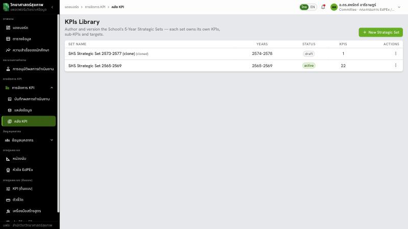

| คอลัมน์ | ความหมาย |
|---|---|
| **Set Name** | ชื่อชุด ชุดที่ Clone มาจะมีป้าย *(cloned)* |
| **Years** | ช่วงปี พ.ศ. ของชุด |
| **Status** | **draft** กำลังร่าง · **active** ใช้งาน · **archived** เก็บถาวร |
| **KPIs** | จำนวน KPI ในชุด |

#### สร้างชุดใหม่

1. กดปุ่ม **New Strategic Set** มุมขวาบน
2. กรอก

   | ช่อง | ใส่อะไร |
   |---|---|
   | **Set Name** | ชื่อชุด เช่น *SHS Strategic Set 2568-2572* ต้องกรอก (อย่างน้อย 2 ตัวอักษร) |
   | **Description** | คำอธิบายสั้น ๆ (ไม่บังคับ) |
   | **Start Year (B.E.)** | ปี พ.ศ. ที่เริ่ม |
   | **End Year** | คำนวณให้เอง = ปีเริ่ม + 4 (แก้ไม่ได้) |
   | **Clone from existing set** | **Start empty** = ชุดว่าง หรือเลือกชุดเดิมเพื่อคัดลอก |

   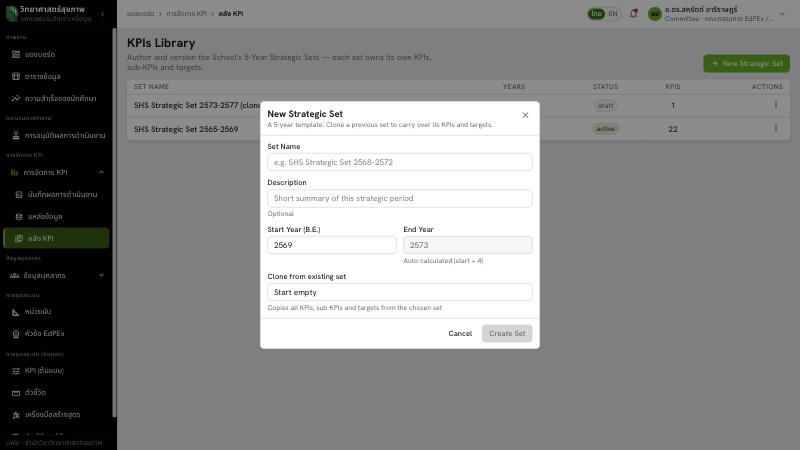

3. กด **Create Set** ระบบพาไปหน้าของชุดใหม่

| ตัวเลือก | ได้อะไร |
|---|---|
| **Start empty** | ชุดว่าง พร้อมหมวดหมู่เริ่มต้น 5 หมวด (Student Success, Faculty Excellence, Research Output, Operational Efficiency, Financial Health) |
| **Clone** | คัดลอกหมวดหมู่ KPI KPI ย่อย เป้าหมายรายปี และสูตรที่เชื่อมไว้ ทั้งหมดจากชุดที่เลือก KPI ที่ยังเป็นฉบับร่างจะยังเป็นฉบับร่างในชุดใหม่ |

> ⚠️ ปีเริ่มต้นและชื่อชุด **ไม่มีปุ่มแก้ไข**ในหน้านี้หลังสร้างแล้ว ตรวจให้ถูกก่อนกด **Create Set**

#### เปลี่ยนสถานะชุด

1. กดปุ่ม **⋮** ท้ายแถวของชุด
2. เลือก **Set status** แล้วเลือก **Draft** / **Active** / **Archived** (สถานะปัจจุบันมีเครื่องหมายถูก)
3. ยืนยันในหน้าต่าง **Change set status**

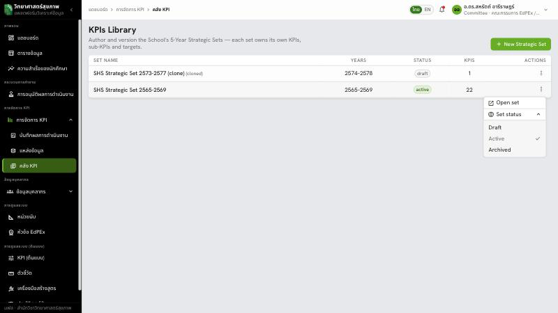

> ระบบใช้สถานะ **Active** ตอน Activate Record (ส่วน 5.1) เลือกได้เฉพาะชุดที่เป็น **Active** ถ้าไม่เห็นชุดของคุณในรายการนั้น ให้กลับมาตั้งเป็น **Active** ก่อน

### 1.2 หน้าชุด: รายการ KPI

คลิกชื่อชุด (หรือ **⋮** → **Open set**)

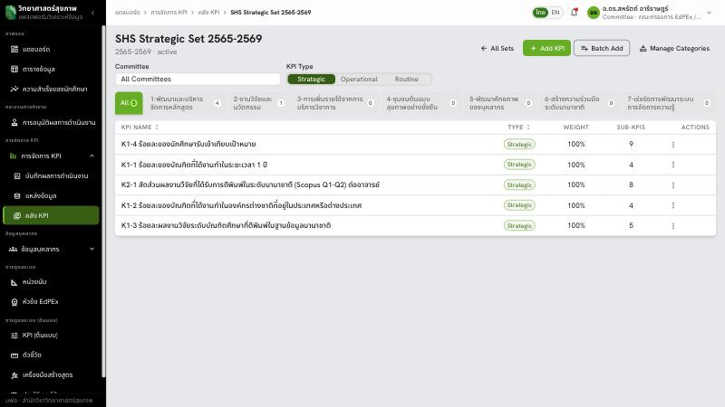

| ส่วน | ใช้ทำอะไร |
|---|---|
| **All Sets** | กลับไปรายการชุด |
| **Add KPI** | เพิ่ม KPI ทีละตัว (หัวข้อ 1.3) |
| **Batch Add** | เพิ่มหลาย KPI พร้อมกัน (หัวข้อ 1.3) |
| **Manage Categories** | จัดการหมวดหมู่ (หัวข้อ 1.4) |
| ตัวกรอง **Committee** | แสดงเฉพาะ KPI ของคณะกรรมการที่เลือก |
| ตัวกรอง **KPI Type** | **Strategic** / **Operational** / **Routine** |
| แท็บหมวดหมู่ | แสดงเฉพาะหมวดที่เลือก ตัวเลขในแท็บคือจำนวน KPI |

ตารางมีคอลัมน์ **KPI Name**, **Type**, **Weight**, **Sub-KPIs** (จำนวน KPI ย่อย) และ **Actions**

- KPI ที่ยังเป็นฉบับร่างมีป้าย **Draft** ต่อท้ายชื่อ (หัวข้อ 1.8)
- คลิกแถว หรือ **⋮** → **Configure** เพื่อเปิดหน้า KPI รายตัว
- **⋮** → **Delete** เพื่อลบ KPI ระบบให้พิมพ์ `DELETE` ยืนยัน และบอกว่าจะลบเป้าหมายรายปีและ KPI ย่อยด้วย KPI จะหายจาก Record ที่ใช้งานอยู่ (Record ที่ปิดแล้วเก็บประวัติไว้) ลบแล้วกู้คืนไม่ได้

> ⚠️ ถ้า Record ที่ **active** มีผลที่บันทึกไว้แล้วของ KPI นี้ (หรือ KPI ย่อย) ระบบ**ไม่ให้ลบ** และแจ้ง "Can't delete: an active performance record already has recorded progress…" ให้ปิดหรือปรับ Record นั้นก่อน

### 1.3 เพิ่ม KPI

#### เพิ่มทีละตัว: Add KPI

1. กดปุ่ม **Add KPI**
2. กรอก

   | ช่อง | ใส่อะไร | ค่าเริ่มต้น |
   |---|---|---|
   | **KPI Name** | ชื่อ KPI ต้องกรอก | — |
   | **Category** | หมวดหมู่ (**Uncategorised** = ไม่ระบุ) | Uncategorised |
   | **KPI Type** | **Strategic** / **Operational** / **Routine** | Operational |
   | **Weight (%)** | น้ำหนัก 0–100 | 10 |
   | **Unit** | หน่วยของ KPI เลือกจากรายการ | Item |
   | **EdPEx Topic / Area / Indicator Code** | ข้อมูล EdPEx (ไม่บังคับ) | — |

   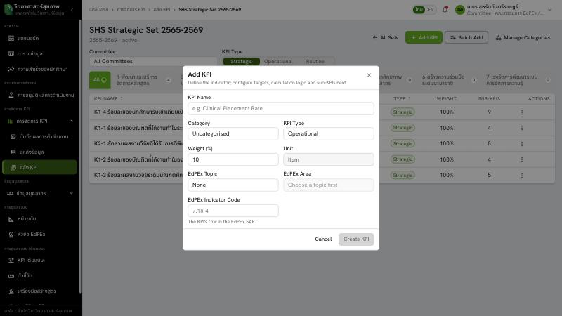

3. กด **Create KPI** ระบบสร้าง KPI เป็นฉบับร่าง และเปิดหน้า KPI รายตัวให้ตั้งค่าต่อ

> รายการ **Category** เปลี่ยนตามประเภท: **Routine** ใช้หมวดหมู่งานประจำ (ชื่อขึ้นต้นด้วย "ด้านที่") ประเภทอื่นใช้หมวดหมู่ **Strategic**

#### เพิ่มหลายตัว: Batch Add

เหมาะเมื่อมี KPI จำนวนมาก (สูงสุด 500 ตัวต่อครั้ง)

1. กดปุ่ม **Batch Add** จะได้ตารางแถวว่าง
2. กรอกในตารางโดยตรง หรือวางแถวจาก Excel ลงช่อง **KPI NAME** (คอลัมน์: Name, Type, Category, Committee, Description, EdPEx Topic, EdPEx Area, EdPEx Indicator) หรือกด **Import CSV**
3. ปุ่มช่วย: **Add row** เพิ่มแถว · **Template** ดาวน์โหลดแม่แบบ CSV · **Clear** ล้างตาราง · ลูกศรชี้ลงที่หัวคอลัมน์ คัดลอกค่าของแถวแรกลงทุกแถว
4. ดูสถานะท้ายแต่ละแถว: *empty, skipped* (แถวว่าง ข้าม) · ข้อความสีแดง (ผิดพลาด ต้องแก้) · *Another KPI has this name* (มี KPI ชื่อนี้อยู่แล้ว)
5. ท้ายหน้าต่างบอกจำนวน (เช่น "0 ready") กด **Create N KPIs**

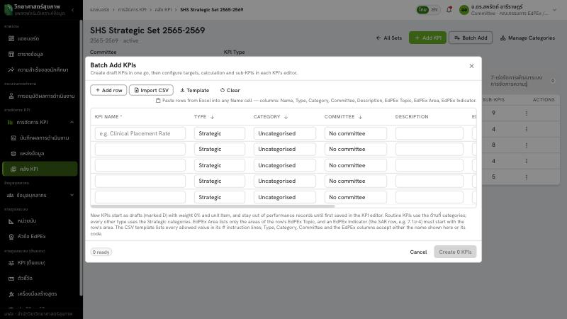

> ⚠️ KPI จาก Batch Add เป็นฉบับร่าง **น้ำหนัก 0% หน่วย Item** และยังไม่อยู่ใน Record จนกว่าจะเปิดแต่ละตัวมาตั้งค่าและกดบันทึกครั้งแรก

### 1.4 จัดการหมวดหมู่: Manage Categories

1. กดปุ่ม **Manage Categories**
2. แต่ละแถวคือหนึ่งหมวด: จับที่ไอคอนซ้ายแล้ว**ลากเพื่อเรียงลำดับ** · แก้ชื่อ · แก้คำอธิบาย · เลือกประเภท (**Strategic** / **Routine**) แล้วกด **Save** ที่แถวนั้น
3. เพิ่มหมวดใหม่ที่ล่างสุด: พิมพ์ **New category** เลือก **Type** แล้วกด **Add**
4. ถังขยะท้ายแถวลบหมวด (มีหน้าต่างยืนยัน)

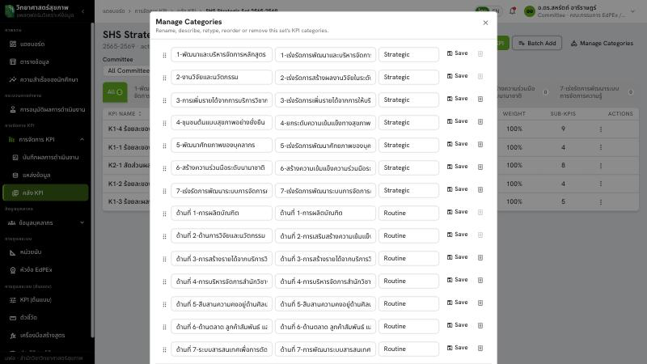

| เรื่อง | กติกา |
|---|---|
| ประเภทหมวดหมู่ | **Strategic** ใช้กับ KPI ประเภท Strategic และ Operational · **Routine** ใช้กับ KPI ประเภท Routine (หมวด "ด้านที่ …") |
| ลบหมวด | ลบไม่ได้ถ้ายังมี KPI ใช้หมวดนั้นอยู่ ปุ่มถังขยะจะจาง และเมื่อเอาเมาส์ชี้จะบอกว่ามีกี่ KPI ใช้อยู่ ให้ย้าย KPI ไปหมวดอื่นก่อน |
| หมวดหมู่เป็นของชุด | แต่ละชุดมีหมวดหมู่ของตัวเอง ชุดที่ Clone จะคัดลอกหมวดหมู่ไปด้วย |

### 1.5 หน้า KPI รายตัว: การตั้งค่าหลัก และเป้าหมาย

คลิกแถว KPI (หรือ **Configure**) หน้าจอแบ่งเป็นการ์ด: **การตั้งค่าหลัก**, **เป้าหมายรายปี (5 ปี)**, **ตรรกะการคำนวณ KPI** (ด้านซ้าย) และ **การตั้งค่าเกณฑ์**, **การรวมผล** (ด้านขวา) ปุ่มด้านบนคือ **กลับไปยังชุด**, **บันทึกการเปลี่ยนแปลง** และถังขยะ (**ลบ KPI**)

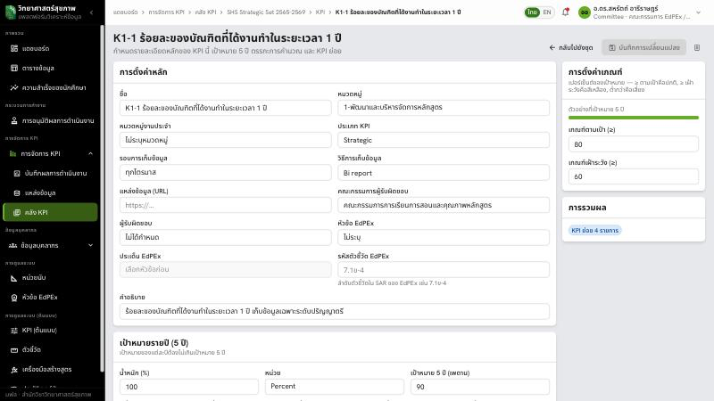

#### การตั้งค่าหลัก

| ช่อง | ความหมาย |
|---|---|
| **ชื่อ** | ชื่อ KPI |
| **หมวดหมู่** / **หมวดหมู่งานประจำ** | หมวดของ KPI (ช่องที่ใช้ขึ้นกับ **ประเภท KPI**) |
| **ประเภท KPI** | Strategic / Operational / Routine |
| **รอบการเก็บข้อมูล** | **ทุกไตรมาส** หรือเฉพาะ **ไตรมาส 1–4** |
| **วิธีการเก็บข้อมูล** | เช่น แบบสำรวจ การส่งออกจากทะเบียน |
| **แหล่งข้อมูล (URL)** | ลิงก์แหล่งข้อมูล (เป็นข้อความอธิบาย ไม่เกี่ยวกับ "แหล่งข้อมูล" ในส่วน 2) |
| **คณะกรรมการผู้รับผิดชอบ** | คณะกรรมการเจ้าของ KPI |
| **ผู้รับผิดชอบ** | เลือกได้หลังเลือกคณะกรรมการ (ระบบแจ้ง "เลือกคณะกรรมการผู้รับผิดชอบก่อนจึงจะเลือกบุคคลได้") |
| **คำอธิบาย** | KPI นี้วัดอะไร |
| **หัวข้อ EdPEx** / **ประเด็น EdPEx** / **รหัสตัวชี้วัด EdPEx** | ถ้าเกี่ยวกับ EdPEx เช่น 7.1ข-4 |

#### เป้าหมายรายปี (5 ปี)

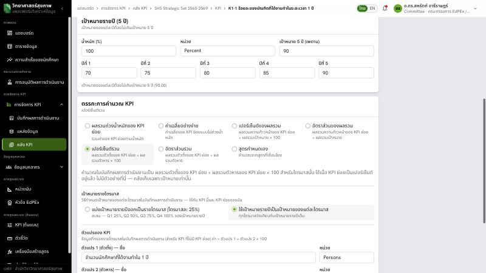

| ช่อง | ความหมาย |
|---|---|
| **น้ำหนัก (%)** | น้ำหนักของ KPI (ใช้เมื่อ KPI นี้เป็นส่วนหนึ่งของการรวมแบบถ่วงน้ำหนัก) |
| **หน่วย** | หน่วยของ KPI เช่น Percent, Ratio, Persons |
| **เป้าหมาย 5 ปี (เพดาน)** | ค่าสูงสุดที่เป้าหมายแต่ละปีห้ามเกิน |
| **ปีที่ 1 – ปีที่ 5** | เป้าหมายของแต่ละปี (แสดงปี พ.ศ. ใต้แท็บของแต่ละ Record) |

- **กติกา** เป้าหมายแต่ละปี**ต้องไม่เกิน**เป้าหมาย 5 ปี (ผลรวมของห้าปีเกินเพดานได้) ถ้าเกิน ระบบแจ้ง "เป้าหมายปีที่ 3 (95.00) ต้องไม่เกินเป้าหมาย 5 ปี (90.00)" และปุ่ม **บันทึกการเปลี่ยนแปลง** กดไม่ได้
- ปล่อยเพดานว่างได้ ระบบจะไม่ตรวจเพดาน
- เมื่อเลือกหน่วย **Percent** หรือ **Ratio** ระบบเลือกตรรกะการคำนวณที่เหมาะให้ก่อน (ปรับได้)

#### บันทึก

กด **บันทึกการเปลี่ยนแปลง** ระบบแจ้ง "KPI updated"

- KPI ที่เป็น **Draft** บันทึกได้แม้ไม่แก้อะไร การบันทึกครั้งแรกคือการ "เผยแพร่" KPI ให้เข้า Record
- การบันทึก/ลบหลังจากนั้น จะอัปเดต Record ที่ **active** ของชุดนั้นให้อัตโนมัติ (ดูหัวข้อ 1.8)

### 1.6 ตรรกะการคำนวณ ตัวแปร และเกณฑ์สี

#### ตรรกะการคำนวณ KPI

ใช้เมื่อ KPI มี**KPI ย่อย** บอกว่าค่า KPI แม่ถูกรวมจาก KPI ย่อยอย่างไร เลือกได้ 7 แบบ

| ตัวเลือก | คำนวณอย่างไร | ใช้เมื่อ |
|---|---|---|
| **ผลรวมถ่วงน้ำหนักของ KPI ย่อย** | รวมค่าของ KPI ย่อยตามน้ำหนัก | KPI ย่อยมีความสำคัญไม่เท่ากัน |
| **ค่าเฉลี่ยอย่างง่าย** | ค่าเฉลี่ยของ KPI ย่อย ไม่ถ่วงน้ำหนัก | KPI ย่อยสำคัญเท่ากัน |
| **เปอร์เซ็นต์ของผลรวม** | ผลรวมความก้าวหน้าของ KPI ย่อย ÷ ผลรวมเป้าหมาย × 100 | KPI หน่วย Percent ที่รวมจากจำนวนนับ |
| **อัตราส่วนของผลรวม** | ผลรวมความก้าวหน้า ÷ ผลรวมเป้าหมาย | KPI หน่วย Ratio |
| **เปอร์เซ็นต์รวม** | ผลรวมตัวตั้งของ KPI ย่อย ÷ ผลรวมตัวหาร × 100 | KPI ย่อยเป็นร้อยละอยู่แล้ว |
| **อัตราส่วนรวม** | ผลรวมตัวตั้ง ÷ ผลรวมตัวหาร | KPI ย่อยเป็นอัตราส่วนอยู่แล้ว |
| **สูตรกำหนดเอง** | เชื่อมกับสูตรที่สร้างไว้ในเครื่องมือสร้างสูตร | ต้องการบันทึกวิธีคำนวณเฉพาะ |

- ถ้าเลือก **ผลรวมถ่วงน้ำหนัก** และน้ำหนัก KPI ย่อยรวมไม่ใช่ 100% ระบบแสดงป้าย **น้ำหนัก** เตือน (เป็นคำเตือน ไม่ห้ามบันทึก) เพราะผลจะถูกคูณตามน้ำหนักนั้น
- **สูตรกำหนดเอง** ⚠️ สูตรที่เชื่อมไว้เป็นเพียง**การบันทึกวิธีคำนวณ ไม่ได้คำนวณอัตโนมัติ** ในบันทึกผลการดำเนินงาน ค่ารายไตรมาสจะว่างจนกว่าจะมีคนกรอก (ปุ่ม **เปิดในเครื่องมือสร้างสูตร** พาไปสร้างสูตร)
- ⚠️ ถ้า KPI นี้ถูก**เชื่อมโยงกับแหล่งข้อมูล** (ส่วน 4) ค่าจากแหล่งข้อมูลมาก่อนตรรกะนี้ ลำดับความสำคัญคือ เชื่อมแหล่งข้อมูล → รวมจาก KPI ย่อย → กรอกเอง

#### เป้าหมายรายไตรมาส

เลือกวิธีกำหนดเป้าของแต่ละไตรมาส ใช้กับ KPI นี้และ KPI ย่อย

| ตัวเลือก | ความหมาย |
|---|---|
| **แบ่งเป้าหมายรายปีออกเป็นรายไตรมาส (ไตรมาสละ 25%)** | สะสม: Q1 25% · Q2 50% · Q3 75% · Q4 100% ของเป้าหมายรายปี |
| **ใช้เป้าหมายรายปีเป็นเป้าหมายของแต่ละไตรมาส** | ทุกไตรมาสวัดเทียบกับเป้าหมายรายปีเต็ม |

#### ตัวแปรของ KPI

ใช้กับ KPI ที่**ไม่มี KPI ย่อย** (กรอกค่าโดยตรง) บอกว่าผู้กรอกต้องกรอกข้อมูลอะไรในบันทึกผล

| ช่อง | ความหมาย |
|---|---|
| **ตัวแปร 1 (ตัวตั้ง) — ชื่อ** และ **หน่วย** | ต้องกรอกเสมอ เช่น *บัณฑิตที่มีงานทำ* |
| **ตัวแปร 2 (ตัวหาร) — ชื่อ** และ **หน่วย** | เปิดให้กรอกเมื่อหน่วย KPI เป็น **Percent** หรือ **Ratio** และต้องกรอก เช่น *บัณฑิตทั้งหมด* |

- ค่า KPI = ตัวแปร 1 (หน่วย Percent: ÷ ตัวแปร 2 × 100, หน่วย Ratio: ÷ ตัวแปร 2) ผู้กรอกจึงกรอกเฉพาะตัวแปร แล้วระบบคำนวณให้ในหน้าบันทึกผล (ส่วน 5.3)
- ถ้าไม่กรอกชื่อตัวแปรที่จำเป็น ระบบแจ้ง "ต้องระบุชื่อตัวแปร 1 (ตัวตั้ง)" หรือ "ต้องระบุชื่อตัวแปร 2 (ตัวหาร) เมื่อหน่วยเป็น Percent หรือ Ratio" และบันทึกไม่ได้

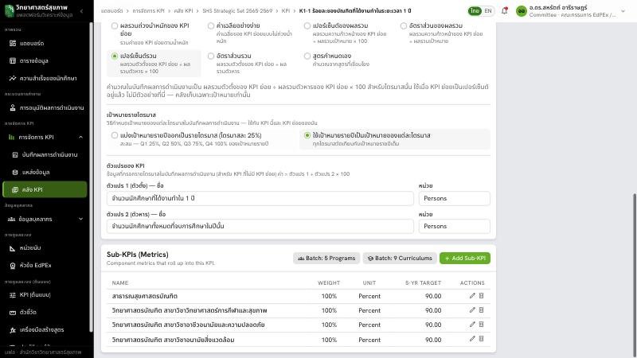

#### เกณฑ์สี: การตั้งค่าเกณฑ์

ด้านขวาของหน้า ใช้บอกว่า KPI อยู่ในสถานะใดเมื่อเทียบกับเป้าหมาย ค่าเป็น**เปอร์เซ็นต์ของเป้าหมาย**

| ช่อง | ค่าเริ่มต้น | ความหมาย |
|---|---|---|
| **เกณฑ์ตามเป้า (≥)** | 100 | ตั้งแต่ค่านี้ขึ้นไป = ปกติ (เขียว, *On Target*) |
| **เกณฑ์เฝ้าระวัง (≥)** | 70 | ตั้งแต่ค่านี้ขึ้นไปแต่ต่ำกว่าตามเป้า = เฝ้าระวัง (เหลือง) ต่ำกว่านี้ = *At risk* (แดง) |

- แถบ **ตัวอย่างที่เป้าหมาย 5 ปี** แสดงสีเมื่อทำได้ 100% ของเป้า
- ถ้าลบค่าในช่อง แล้วบันทึก ระบบใช้ค่าเริ่มต้น 100 และ 70
- สีนี้คือสีที่ผู้ใช้เห็นในหน้าบันทึกผล (ส่วน 5.3)

#### การรวมผล

การ์ด **การรวมผล** บอกว่า **KPI ย่อย N รายการ** (ค่าคำนวณจาก KPI ย่อย) หรือ **KPI ปลายทาง (กรอกโดยตรง)** (ไม่มี KPI ย่อย)

### 1.7 KPI ย่อย

ส่วน **Sub-KPIs (Metrics)** อยู่ล่างสุดของหน้า KPI รายตัว

| ปุ่ม | ทำอะไร |
|---|---|
| **+ Add Sub-KPI** | เพิ่มทีละตัว |
| **Batch: N Programs** | สร้างจากสาขาวิชาในแคตตาล็อก (หนึ่งสาขา = หนึ่ง KPI ย่อย) |
| **Batch: N Curriculums** | สร้างจากหลักสูตรในแคตตาล็อก |
| ไอคอนดินสอ / ถังขยะ ท้ายแถว | แก้ไข / ลบ KPI ย่อย (ลบมีหน้าต่างยืนยัน) |

> ⚠️ ต้อง**บันทึก KPI แม่ก่อน** จึงเพิ่ม KPI ย่อยได้ ถ้ามีการแก้ที่ยังไม่บันทึก ปุ่มทั้งสามจะกดไม่ได้ (เอาเมาส์ชี้จะเห็น "Save the parent KPI before adding sub-KPIs")

#### เพิ่มทีละตัว: Add Sub-KPI

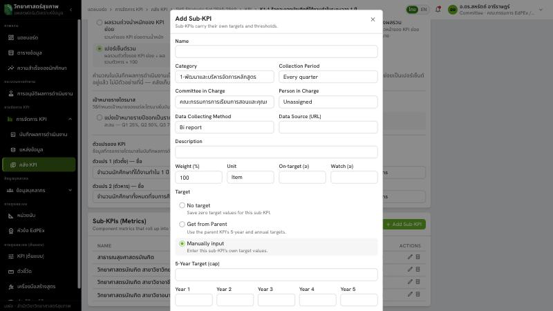

| ช่อง | ความหมาย | ค่าเริ่มต้น |
|---|---|---|
| **Name** | ชื่อ KPI ย่อย (ต้องกรอก) | — |
| **Category**, **Collection Period**, **Committee in Charge**, **Person in Charge**, **Data Collecting Method**, **Data Source (URL)**, **Description** | เหมือนของ KPI แม่ | คัดลอกจาก KPI แม่ |
| **Weight (%)** | น้ำหนัก เป็นจำนวนเต็ม 1–100 | 100 |
| **Unit** | หน่วย | Item |
| **On-target (≥)**, **Watch (≥)** | เกณฑ์สีของ KPI ย่อยนี้ (ไม่บังคับ) | — |
| **Target** | วิธีกำหนดเป้า (ตารางด้านล่าง) | Manually input |

| ตัวเลือก **Target** | ความหมาย |
|---|---|
| **No target** | ไม่มีเป้า (บันทึกเป็น 0) |
| **Get from Parent** | ใช้เป้าหมาย 5 ปีและรายปีของ KPI แม่ตามไปด้วย (แก้ที่แม่ ค่าตาม) |
| **Manually input** | กรอกเอง: **5-Year Target (cap)** และ **Year 1–5** (แต่ละปีต้องไม่เกินเพดาน เหมือน KPI แม่) |

#### สร้างหลายตัวจากแคตตาล็อก: Batch Programs / Curriculums

1. กด **Batch: N Programs** (หรือ **Curriculums**) จะเห็นรายการตัวอย่างก่อนสร้าง
2. ตรวจสถานะแต่ละแถว: *will be created* (จะสร้างใหม่) · *will be renamed* (มีอยู่แล้วแต่ชื่อสาขาเปลี่ยน จะเปลี่ยนชื่อให้) · *already exists — skipped* (มีอยู่แล้ว ข้าม) · *already exists — will be linked*
3. กด **Create N Sub-KPIs** (หรือ **Cancel** ถ้ายังไม่ต้องการ)

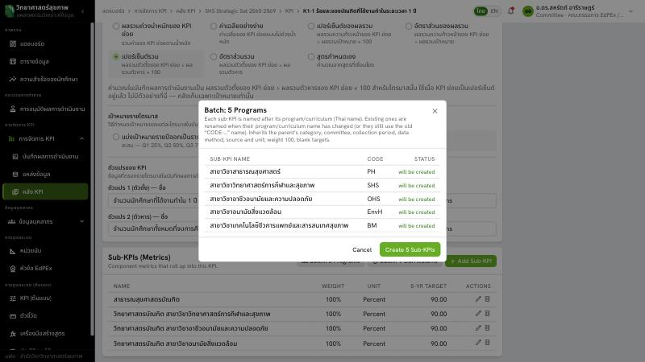

- ชื่อ KPI ย่อยตั้งตามชื่อสาขา/หลักสูตร (ภาษาไทย) พร้อมรหัส
- แต่ละตัวคัดลอกหมวดหมู่ คณะกรรมการ รอบการเก็บข้อมูล วิธีเก็บ แหล่งข้อมูล และหน่วยจาก KPI แม่ น้ำหนัก 100 และ**เป้าหมายว่าง** ให้ไปตั้งเป้าต่อ

> **ถ้าไม่มี KPI ย่อย** KPI นั้นให้กรอกค่ารายไตรมาสโดยตรง ("This KPI takes direct quarterly entry until you add sub-KPIs") **ถ้ามี KPI ย่อย** ค่า KPI แม่คำนวณจาก KPI ย่อยตามตรรกะในหัวข้อ 1.6 และผู้กรอกจะกรอกที่ KPI ย่อย

### 1.8 จากคลังไปสู่งานจริง

| สิ่งที่ทำในคลัง | เกิดอะไรขึ้น |
|---|---|
| เพิ่ม KPI (Add KPI / Batch Add) | KPI เป็น **Draft** ยังไม่อยู่ใน Record |
| กด **บันทึกการเปลี่ยนแปลง** ครั้งแรก | KPI เลิกเป็น Draft และเข้า Record ที่ **active** ของชุด |
| แก้ KPI / เป้าหมาย แล้วบันทึก | ระบบอัปเดต Record ที่ **active** ของชุดให้เอง ความคืบหน้าที่กรอกแล้วไม่หาย |
| ลบ KPI | หายจาก Record ที่ active (ลบไม่ได้ถ้ามีผลที่บันทึกแล้ว) |
| ตั้งชุดเป็น **Active** แล้ว Activate Record | ได้ Record ซึ่งเป็น**สำเนา**ของชุด ณ ตอนนั้น (ส่วน 5.1) |
| เชื่อมโยง KPI กับแหล่งข้อมูล | เลือก **ชุดยุทธศาสตร์ → KPI → ตัวชี้วัด** จากคลัง (ส่วน 4.1) |

- ถ้าแก้ในคลังแล้วยังไม่เห็นการเปลี่ยนแปลงใน Record ให้กด **Sync from Library** ที่หน้า Record (ส่วน 5.1)
- Record ที่ไม่ใช่ **active** ไม่ถูกอัปเดตตามการแก้ในคลัง

### 1.9 ข้อควรระวัง และแก้ปัญหา

| อาการ | สาเหตุ | วิธีแก้ |
|---|---|---|
| ปุ่ม **บันทึกการเปลี่ยนแปลง** กดไม่ได้ | เป้าหมายปีใดปีหนึ่งเกินเพดาน หรือยังไม่ได้กรอกชื่อตัวแปร 1 (และตัวแปร 2 เมื่อหน่วย Percent/Ratio) | แก้ตามข้อความสีแดง หรือเว้นเพดานว่าง |
| ปุ่ม **Add Sub-KPI** / **Batch** กดไม่ได้ | มีการแก้ KPI แม่ที่ยังไม่บันทึก | กด **บันทึกการเปลี่ยนแปลง** ก่อน |
| ลบ KPI ไม่ได้ ("Can't delete…") | Record ที่ active มีผลที่บันทึกแล้ว | ปรับหรือปิด Record นั้นก่อน |
| ลบหมวดหมู่ไม่ได้ | ยังมี KPI ใช้หมวดนั้น | ย้าย KPI ไปหมวดอื่นก่อน |
| ไม่เห็นชุดในหน้า Activate Record | ชุดนั้นไม่ใช่ **Active** | ตั้ง **Set status** เป็น **Active** |
| KPI ใน Record ไม่ตรงกับคลัง | KPI ยังเป็น Draft หรือ Record ไม่ใช่ **active** | บันทึก KPI ให้พ้นสถานะ Draft และตรวจสถานะ Record แล้วกด **Sync from Library** |
| Batch Add สร้างไม่ได้ | แถวมีข้อผิดพลาด หรือเกิน 500 แถว | แก้แถวที่ขึ้นสีแดง หรือแบ่งเป็นหลายชุด |
| น้ำหนัก KPI ย่อยรวมไม่ใช่ 100% | ใช้ผลรวมถ่วงน้ำหนัก | ปรับน้ำหนัก หรือเปลี่ยนเป็นตรรกะอื่น |

---

## 2. จัดการแหล่งข้อมูล

### 2.1 สร้างแหล่งข้อมูลใหม่ (ผู้ดูแลระบบ)

1. เมนูด้านซ้าย เลือก **การจัดการ KPI** แล้วเลือก **แหล่งข้อมูล**
2. กดปุ่ม **สร้างแหล่งข้อมูลใหม่** มุมขวาบน

   

3. กรอกในหน้าต่างที่เปิดขึ้น

   | ช่อง | ใส่อะไร | หมายเหตุ |
   |---|---|---|
   | **ชื่อ** | ชื่อที่สื่อความหมาย เช่น *แบบสำรวจการมีงานทำของบัณฑิต* | ต้องกรอก |
   | **คำอธิบาย** | ข้อมูลนี้คืออะไร มาจากไหน | ไม่บังคับ |
   | **คณะกรรมการเจ้าของ** | คณะกรรมการที่รับผิดชอบข้อมูลนี้ | เฉพาะสมาชิกของคณะกรรมการนี้เท่านั้นที่บันทึกข้อมูลได้ |
   | **ความถี่ของข้อมูล** | **รายไตรมาส** (ระบุปี + ไตรมาส) หรือ **รายปี** (ระบุเฉพาะปี) | ⚠️ เปลี่ยนไม่ได้หลังมีข้อมูลแล้ว คิดให้ดีก่อน |

   

4. กดปุ่ม **สร้าง** ระบบแจ้งว่า "สร้างแหล่งข้อมูล "…" แล้ว"
5. ระบบพาคุณไปหน้ารายละเอียด ซึ่งยังไม่มีคอลัมน์ ไปต่อที่ [หัวข้อ 3](#3-แก้ไขคอลัมน์)

### 2.2 แก้ไขรายละเอียด หรือเก็บถาวร (ผู้ดูแลระบบ)

1. เปิดแหล่งข้อมูลที่ต้องการ
2. กดปุ่ม **แก้ไขรายละเอียด** ด้านบน
3. แก้ชื่อ คำอธิบาย หรือคณะกรรมการเจ้าของ แล้วกด **บันทึก**
4. ช่อง **สถานะ** เลือก **เก็บถาวร** ได้ ถ้าเลิกเก็บข้อมูลนี้แล้ว
   แหล่งข้อมูลที่เก็บถาวรยังแสดงอยู่ แต่บอกให้รู้ว่าไม่มีการเก็บข้อมูลเพิ่ม

> การแก้ไขรายละเอียดไม่กระทบคอลัมน์และข้อมูลที่บันทึกไว้

### 2.3 ลบแหล่งข้อมูล (ผู้ดูแลระบบ)

> ⚠️ **ลบแล้วกู้คืนไม่ได้** ระบบจะลบทั้งคอลัมน์ ข้อมูลทุกแถว และการเชื่อมโยง KPI ของแหล่งข้อมูลนั้น
> ถ้าแค่เลิกใช้ ให้ใช้ **เก็บถาวร** ในหัวข้อ 2.2 แทน

1. เปิดแหล่งข้อมูล กดปุ่ม **ลบ** (สีแดง)
2. หน้าต่างยืนยันบอกจำนวนข้อมูลและการเชื่อมโยงที่จะหายไป อ่านให้ครบ
3. พิมพ์คำว่า `DELETE THIS DS` ให้ตรงทุกตัวอักษร ในช่องใต้ข้อความ (ช่องนี้และปุ่ม Cancel ยังเป็นภาษาอังกฤษ)
4. กด **ลบแหล่งข้อมูล** (ปุ่มจะกดได้เมื่อพิมพ์ถูกต้อง) ถ้าไม่ต้องการลบ ให้กด **Cancel**

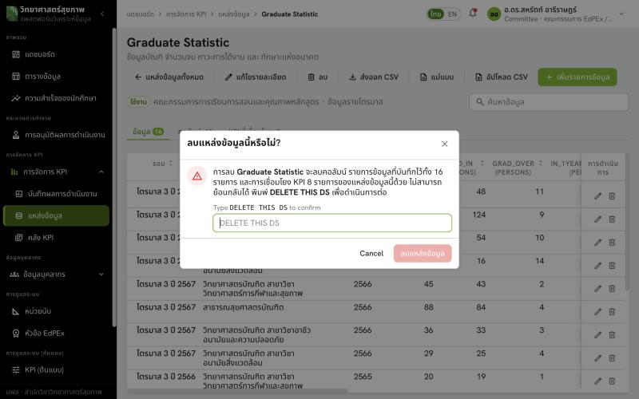

### 2.4 รู้จักหน้ารายละเอียด

หน้ารายละเอียดมี 3 แท็บ ตัวเลขข้างชื่อแท็บคือจำนวนรายการ

| แท็บ | ใช้ทำอะไร |
|---|---|
| **ข้อมูล** | ดู เพิ่ม แก้ไขแถวข้อมูล |
| **คอลัมน์** | ดูว่าตารางมีช่องอะไรบ้าง (กด **จัดการคอลัมน์** เพื่อแก้) |
| **KPI ที่เชื่อมโยง** | ดูว่าข้อมูลนี้ป้อนค่าให้ KPI ตัวไหน (กด **เชื่อมโยง KPI** เพื่อเพิ่ม) |

ปุ่มที่เห็นด้านบนจะเปลี่ยนไปตามแท็บที่เปิดอยู่ และตามสิทธิ์ของคุณ

### 2.5 บันทึกข้อมูลลงแหล่งข้อมูล

ทำได้หลังกำหนดคอลัมน์แล้ว (หัวข้อ 3) มี 2 วิธี

#### วิธี ก. เพิ่มทีละรายการ

1. แท็บ **ข้อมูล** กด **เพิ่มรายการข้อมูล** (ปุ่มเขียวมุมขวาบน)
2. ส่วน **ต้องการเพิ่มอะไร** ปกติเลือก **รายการเดียว**
3. เลือก **ปี พ.ศ.** (4 หลัก เช่น 2569) และ **ไตรมาส** ถ้าเป็นแหล่งข้อมูลรายไตรมาส
4. กรอกค่าในแต่ละคอลัมน์ ช่องที่มีเครื่องหมาย `*` ต้องกรอก ใต้ชื่อช่องบอกประเภทและหน่วย เช่น "ตัวเลข · Persons"
5. ใส่ **หมายเหตุ** ถ้าต้องการ (ไม่บังคับ)
6. กดปุ่ม **เพิ่มรายการข้อมูล** ท้ายหน้าต่าง ระบบแจ้งว่า "บันทึกรายการข้อมูลแล้ว"

ตัวเลือกอื่นในส่วน **ต้องการเพิ่มอะไร**

| ตัวเลือก | ใช้เมื่อ |
|---|---|
| **หลายแถว** | กรอกหลายแถวพร้อมกัน วางจาก Excel หรือเพิ่มทีละแถว ทุกแถวใช้รอบเวลาเดียวกัน |
| **N สาขาวิชา / N หลักสูตร** | ปรากฏเมื่อแหล่งข้อมูลมีคอลัมน์สาขาวิชา/หลักสูตร ระบบสร้างหนึ่งแถวต่อหนึ่งสาขา/หลักสูตรให้ คุณกรอกเฉพาะตัวเลข |

#### วิธี ข. อัปโหลดไฟล์ CSV

เหมาะเมื่อมีข้อมูลจำนวนมากอยู่ใน Excel แล้ว

1. กด **แม่แบบ** (ปุ่มด้านบนของหน้า) เพื่อดาวน์โหลดไฟล์ตัวอย่าง ไฟล์นี้มีหัวตารางที่ถูกต้อง และมีรายการค่าที่ใช้ได้ของแต่ละคอลัมน์
2. เปิดด้วย Excel กรอกข้อมูลทีละแถว **ห้ามแก้แถวหัวตาราง**
3. บันทึกเป็นไฟล์ CSV
4. กด **อัปโหลด CSV** วางไฟล์ หรือกด **เลือกไฟล์ CSV**
5. ระบบตรวจไฟล์และแสดงผลเป็นตาราง แถวที่มีปัญหาขึ้นสถานะ **ผิดพลาด** / **ไม่ครบ** / **ซ้ำ**
6. เลือกวิธีนำเข้า

   | ปุ่ม | ผล |
   |---|---|
   | **นำเข้าเฉพาะที่ครบ** | นำเข้าแถวที่ถูกต้อง ข้ามแถวที่ไม่ครบ |
   | **นำเข้าพร้อมติดธงไม่ครบ** | นำเข้าทุกแถว แถวที่ไม่ครบถูกติดธง แต่ระบบยังไม่นับแถวนั้นใน KPI |

   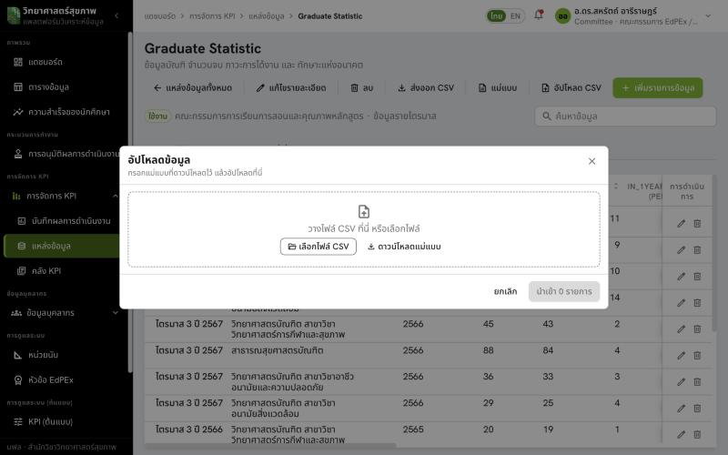

> ⚠️ ไฟล์ต้องไม่ใหญ่เกิน 2 MB ถ้าใหญ่กว่านั้น ให้แบ่งนำเข้าทีละชุด
> แถวที่มีข้อผิดพลาดต้องกลับไปแก้ในไฟล์ แล้วอัปโหลดใหม่

#### แถวที่ "ไม่ครบ" คืออะไร

แถวที่ยังเว้นช่องจำเป็นว่างไว้ จะมีป้าย **ไม่ครบ** สีส้ม และ**ไม่ถูกนับใน KPI ใดเลย** จนกว่าจะกรอกครบ
เมื่อกรอกครบแล้วบันทึก ระบบนับให้ทันที
ด้านบนของตารางมีปุ่ม **ไม่ครบ (จำนวน)** กดเพื่อดูเฉพาะแถวเหล่านี้

#### ค้นหา และส่งออก

- ช่อง **ค้นหาข้อมูล** กรองแถวในตาราง
- ปุ่ม **ส่งออก CSV** ดาวน์โหลดข้อมูลทั้งหมดเป็นไฟล์ (ปุ่มนี้ปรากฏเมื่อมีข้อมูลแล้ว)

---

## 3. แก้ไขคอลัมน์

**คอลัมน์** คือช่องของตาราง เช่น "สาขาวิชา" "จำนวนบัณฑิต" "จำนวนที่ได้งานทำ"
ผู้ที่แก้คอลัมน์ได้คือผู้ดูแลระบบ และเลขานุการของคณะกรรมการเจ้าของ

> **ตัวอย่างที่ใช้ตลอดคู่มือ** แหล่งข้อมูล "แบบสำรวจการมีงานทำของบัณฑิต"
> ใช้คำนวณ KPI "ร้อยละบัณฑิตที่ได้งานทำภายใน 1 ปี"
>
> | ชื่อที่แสดง | ประเภท | จำเป็น |
> |---|---|:---:|
> | สาขาวิชา | สาขาวิชา | ✅ |
> | จำนวนบัณฑิตที่สำเร็จการศึกษา | ตัวเลข | ✅ |
> | จำนวนบัณฑิตที่ได้งานทำ | ตัวเลข | ✅ |

### 3.1 เพิ่มคอลัมน์

1. เปิดแท็บ **คอลัมน์** แล้วกดปุ่ม **จัดการคอลัมน์** (ถ้ายังไม่มีคอลัมน์ ปุ่มนี้อยู่กลางหน้าจอด้วย)

   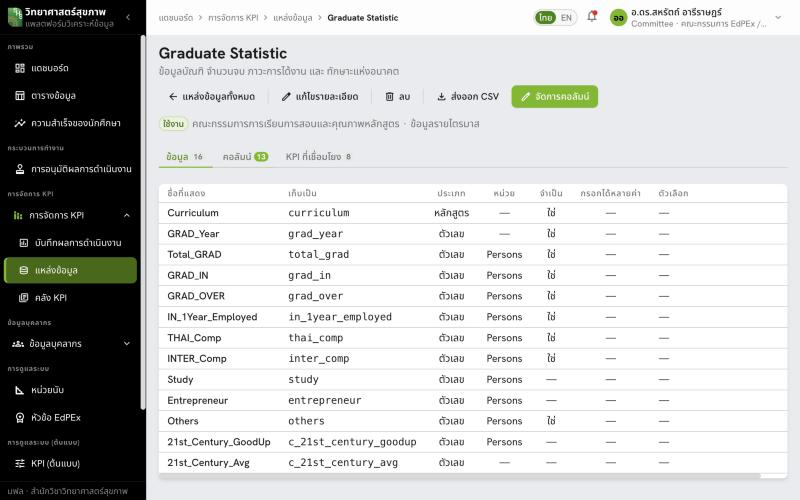

2. กด **เพิ่มคอลัมน์** ด้านล่าง จะได้การ์ดใหม่ 1 ใบ
3. กรอก

   | ช่อง | ความหมาย |
   |---|---|
   | **ชื่อที่แสดง** | ชื่อหัวคอลัมน์ที่ผู้ใช้เห็น เช่น *จำนวนนักศึกษา* ต้องกรอกทุกคอลัมน์ |
   | **ประเภท** | ชนิดข้อมูล ดูตารางในข้อ 3.2 |
   | **หน่วย** | ปรากฏเฉพาะประเภท **ตัวเลข** เช่น คน บาท ร้อยละ |
   | **จำเป็น** | ติ๊กถ้าต้องกรอกทุกครั้ง ถ้าเว้นว่าง แถวนั้นจะเป็นแถว "ไม่ครบ" |

4. ใต้การ์ดมีข้อความ **เก็บเป็น** ตามด้วยรหัสสั้น ๆ นี่คือ "ชื่อที่ระบบใช้เก็บ" สร้างให้เอง ไม่ต้องกรอก
5. เพิ่มคอลัมน์ให้ครบ แล้วกด **บันทึกคอลัมน์** ระบบแจ้งว่า "บันทึกคอลัมน์แล้ว"

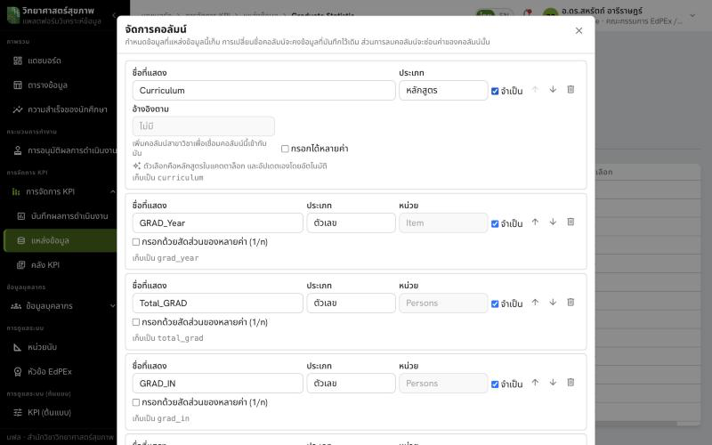

> ถ้าปุ่ม **บันทึกคอลัมน์** กดไม่ได้ ให้ดูข้อความสีแดงใต้รายการ ระบบบอกว่าติดตรงไหน (เช่น ยังไม่ตั้งชื่อ หรือคอลัมน์แบบตัวเลือกยังไม่มีตัวเลือก)

### 3.2 เลือกประเภทให้ถูก

| ประเภท | ใช้เมื่อ | ตัวอย่าง |
|---|---|---|
| **ข้อความ** | พิมพ์อะไรก็ได้ | ชื่อโครงการ |
| **URL** | ลิงก์เว็บ ต้องขึ้นต้น http หรือ https | ลิงก์หลักฐาน |
| **ตัวเลข** | ใช้บวก เฉลี่ย หรือหาร ใน KPI | จำนวนคน จำนวนเงิน |
| **วันที่** | วัน/เดือน/ปี พ.ศ. (วว/ดด/ปปปป) | 15/03/2569 |
| **ตัวเลือก** | เลือกจากรายการที่กำหนดเอง | ตรี, โท, เอก |
| **ใช่ / ไม่ใช่** | มีสองคำตอบ | ได้รับทุนหรือไม่ |
| **บุคลากร** | เลือกจากทำเนียบบุคลากร (เฉพาะคนที่ยังปฏิบัติงาน) | ผู้รับผิดชอบโครงการ |
| **สาขาวิชา** | เลือกจากแคตตาล็อกสาขาวิชา | สาขาวิชาของบัณฑิต |
| **หลักสูตร** | เลือกจากแคตตาล็อกหลักสูตร | หลักสูตรของนักศึกษา |
| **ปี พ.ศ.** | ปีตัวเลข 4 หลัก | 2569 |
| **เดือน** | เลขเดือน 1–12 | 3 (มีนาคม) |

ประเภท **บุคลากร สาขาวิชา หลักสูตร** มีรายการตัวเลือกที่ระบบอัปเดตให้เอง ไม่ต้องพิมพ์ตัวเลือกเอง

> ⚠️ **คิดให้ดีก่อนเลือกประเภทตัวเลข** ถ้าจะนำคอลัมน์ไปรวม เฉลี่ย หรือหารใน KPI ต้องเป็นประเภท **ตัวเลข** เท่านั้น เช่น "จำนวนบัณฑิต" ห้ามตั้งเป็น **ข้อความ**

### 3.3 ตัวเลือกพิเศษ

**คอลัมน์ประเภท ตัวเลือก**
ช่อง **ตัวเลือก** ใส่ค่าที่อนุญาต คั่นด้วยเครื่องหมายจุลภาค เช่น `ตรี, โท, เอก` ต้องมีอย่างน้อย 1 ตัวเลือก

**อ้างอิงตาม** (เฉพาะคอลัมน์บุคลากรและหลักสูตร)
ผูกคอลัมน์นี้กับคอลัมน์ **สาขาวิชา** ในตารางเดียวกัน ผลคือ เลือกสาขาวิชาแล้วรายการบุคลากรแคบลงเฉพาะสาขานั้น และถ้าเลือกบุคลากรก่อน ระบบกรอกสาขาวิชาให้เอง
ต้องมีคอลัมน์สาขาวิชาอยู่ในรายการก่อน ไม่เช่นนั้นช่องนี้เลือกไม่ได้

**กรอกได้หลายค่า**
ใช้เมื่อหนึ่งรายการมีหลายค่า เช่น โครงการเดียวมีผู้เขียนหลายคน ระบบเก็บเป็นหนึ่งแถวต่อหนึ่งค่า
⚠️ ตั้งได้**เพียงคอลัมน์เดียว**ต่อแหล่งข้อมูล ถ้าติ๊กคอลัมน์ใหม่ คอลัมน์เดิมจะถูกยกเลิกอัตโนมัติ

**กรอกด้วยสัดส่วนของหลายค่า (1/n)** (เฉพาะประเภทตัวเลข)
ใช้คู่กับ "กรอกได้หลายค่า" ถ้ามีผู้เขียน 4 คน แต่ละแถวได้ค่า 1/4 อัตโนมัติ ใช้ตอนต้องแบ่งผลงานให้เท่ากัน

### 3.4 เรียงลำดับ เปลี่ยนชื่อ ลบ

| ต้องการ | ทำอย่างไร |
|---|---|
| เรียงลำดับ | กดลูกศร **เลื่อนขึ้น** / **เลื่อนลง** ท้ายการ์ด |
| เปลี่ยนชื่อ | แก้ **ชื่อที่แสดง** แล้ว **บันทึกคอลัมน์** ข้อมูลเดิมยังอยู่ครบ |
| ลบคอลัมน์ | กดถังขยะ **ลบคอลัมน์** แล้ว **บันทึกคอลัมน์** |

> ⚠️ การลบคอลัมน์จะ**ซ่อนค่า**ของคอลัมน์นั้น และถ้าคอลัมน์นั้นถูกใช้ในการเชื่อม KPI อยู่ ให้เปิดการเชื่อมโยงไปตรวจก่อนลบ
> ถ้ากดยกเลิก การแก้ไขที่ยังไม่บันทึกจะหายทั้งหมด

---

## 4. เชื่อมโยง KPI

การเชื่อมโยงคือการบอกระบบว่า "ข้อมูลในตารางนี้ นับอย่างไร จึงได้ค่า KPI ตัวนี้"

> **ตัวอย่าง** จากตาราง "แบบสำรวจการมีงานทำของบัณฑิต" ปีการศึกษา 2569 มีบัณฑิต 120 คน ได้งานทำ 96 คน
> → ระบบคำนวณ KPI "ร้อยละบัณฑิตที่ได้งานทำ" = 96 ÷ 120 × 100 = **80%** ให้เอง

ผู้ที่เชื่อมโยงได้คือผู้ดูแลระบบ และเลขานุการของคณะกรรมการเจ้าของ (เลขานุการเชื่อมได้เฉพาะ KPI ของคณะกรรมการที่ตนสังกัด)

### 4.1 เลือกเป้าหมาย

1. เปิดแท็บ **KPI ที่เชื่อมโยง** กดปุ่ม **เชื่อมโยง KPI**

   

2. เลือกเป้าหมายตามลำดับ

   | ช่อง | เลือกอะไร |
   |---|---|
   | **ชุดยุทธศาสตร์** | ชุดยุทธศาสตร์ที่ KPI อยู่ (ต้องเลือกก่อน) |
   | **คณะกรรมการ** | ช่วยกรองรายการ KPI ให้สั้นลง ค่าเริ่มต้นคือคณะกรรมการเจ้าของ |
   | **KPI** | KPI ที่ต้องการป้อนค่าให้ |
   | **ตัวชี้วัด** | ไม่บังคับ ถ้าเว้นว่าง (**KPI นั้นเอง**) ค่าจะป้อนให้ KPI โดยตรง ถ้าเลือกตัวชี้วัด ค่าจะป้อนให้ตัวชี้วัดนั้น |

   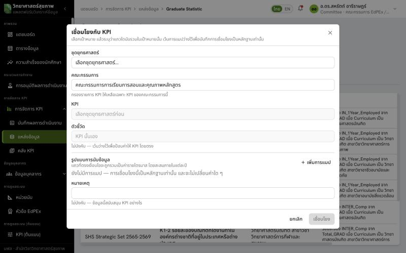

> ⚠️ เลือกเป้าหมายได้ครั้งเดียว ตอนสร้าง หลังบันทึกแล้วเปลี่ยนเป้าหมายไม่ได้ ถ้าเลือกผิด ให้ยกเลิกการเชื่อมโยงแล้วทำใหม่

### 4.2 บอกว่าจะนับอย่างไร

ส่วน **รูปแบบการนับข้อมูล** อยู่ใต้ช่องเลือกเป้าหมาย

1. กด **เพิ่มการแมป**
2. ช่อง **การรวมค่า** เลือกวิธีนับ

   | ตัวเลือก | ทำอะไร | ตัวอย่าง |
   |---|---|---|
   | **ผลรวมของ** | บวกค่าในคอลัมน์ตัวเลข | รวมงบวิจัยทุกโครงการ |
   | **ค่าเฉลี่ยของ** | หาค่าเฉลี่ยของคอลัมน์ตัวเลข | คะแนนความพึงพอใจเฉลี่ย |
   | **จำนวนแถว** | นับว่ามีกี่แถว | จำนวนโครงการ |
   | **จำนวนแถว (ไม่ซ้ำ)** | นับกี่ค่าที่ไม่ซ้ำกัน | จำนวนบทความ (ไม่นับซ้ำเมื่อมีหลายผู้เขียน) |
   | **ค่าล่าสุดของ** | ใช้ค่าล่าสุดที่บันทึก | จำนวนนักศึกษาทั้งหมดล่าสุด |
   | **ร้อยละของ** | ตัวตั้ง ÷ ตัวหาร × 100 | ร้อยละบัณฑิตที่ได้งานทำ |
   | **อัตราส่วนของ** | ตัวตั้ง ÷ ตัวหาร (ไม่คูณ 100) | อัตราส่วนอาจารย์ต่อนักศึกษา |

3. ช่อง **คอลัมน์** เลือกคอลัมน์ที่จะนำมาคำนวณ
   - **ผลรวมของ / ค่าเฉลี่ยของ / ค่าล่าสุดของ** เลือกได้เฉพาะคอลัมน์ประเภทตัวเลข
   - **ร้อยละของ / อัตราส่วนของ** ถ้าเลือก **จำนวนแถว** ระบบนับแถว ถ้าเลือกคอลัมน์ตัวเลข ระบบรวมค่าในคอลัมน์นั้น

> **เคล็ดลับ** ถ้าหน่วยของ KPI เป็นร้อยละ ระบบแสดงข้อความ **เคล็ดลับ** ใต้การแมปว่าให้ใช้ **ร้อยละของ** (ถ้าหน่วยเป็นอัตราส่วน ให้ใช้ **อัตราส่วนของ**) เพราะชนิดนี้เก็บตัวตั้งและตัวหารไว้เป็นหลักฐานของตัวเลข

### 4.3 ตั้งเงื่อนไขว่านับแถวไหนบ้าง

ส่วนที่ขึ้นต้นด้วยคำว่า "…เมื่อ" ใช้กรองแถว ถ้าไม่ตั้งเงื่อนไขเลย ระบบนับ**ทุกแถว**

1. กด **เพิ่มเงื่อนไข**
2. ช่อง **ฟิลด์** เลือกว่าจะกรองด้วยอะไร: **รอบ (ปี / ไตรมาส)** หรือคอลัมน์ใดคอลัมน์หนึ่ง
3. ช่อง **เงื่อนไข** เลือกวิธีเทียบ

   | ตัวเลือก | ความหมาย |
   |---|---|
   | **เป็น** | เท่ากับค่าที่ระบุ |
   | **เป็นหนึ่งใน** | ตรงกับค่าใดค่าหนึ่งในรายการ (เลือกได้หลายค่า) |
   | **ไม่น้อยกว่า** | มากกว่าหรือเท่ากับ |
   | **ไม่เกิน** | น้อยกว่าหรือเท่ากับ |
   | **อยู่ระหว่าง** | ช่วงตั้งแต่ ถึง (ใส่ **ตั้งแต่** และ **ถึง**) |

4. ใส่ **ค่า** แล้วเพิ่มเงื่อนไขอื่นต่อได้ เงื่อนไขทุกข้อต้องเป็นจริงพร้อมกัน ("และ")
5. ลบเงื่อนไขด้วยปุ่ม **ลบเงื่อนไข**

ตัวอย่างเงื่อนไข: "ระดับปริญญา **เป็น** ตรี" หรือ "รอบ **อยู่ระหว่าง** 2568 ไตรมาส 1 → 2569 ไตรมาส 4"

> ระบบรวมแถวที่ตรงเงื่อนไขเป็นค่ารายไตรมาส โดยสะสมภายในแต่ละปี

### 4.4 ร้อยละ และอัตราส่วน: กำหนดตัวหาร

เมื่อเลือก **ร้อยละของ** หรือ **อัตราส่วนของ** จะมีส่วน **จากทั้งหมด** เพิ่มขึ้นมา ให้เลือกตัวหารอย่างใดอย่างหนึ่ง

**แบบ ก. แถวของแหล่งข้อมูลนี้** (ตัวหาร = แถวในตารางนี้)

ทำได้ 2 รูปแบบ

- *ใช้สองคอลัมน์* (เหมาะกับตัวอย่างบัณฑิต)
  - ช่อง **คอลัมน์** เลือก **จำนวนบัณฑิตที่สำเร็จการศึกษา** (ตัวหาร)
  - ช่อง **คอลัมน์ตัวตั้ง** เลือก **จำนวนบัณฑิตที่ได้งานทำ**
  - ไม่ต้องตั้งเงื่อนไขเพิ่ม ระบบคำนวณ 96 ÷ 120 × 100 = 80%
  - ในแหล่งข้อมูล *Graduate Statistic* ของระบบจริงก็ตั้งแบบนี้ (ตัวหาร `Total_GRAD` ตัวตั้ง `IN_1Year_Employed`) และใช้ **เงื่อนไข** กรองให้นับเฉพาะหลักสูตรของ KPI นั้น
- *ใช้คอลัมน์เดียว* ให้ตั้ง "เงื่อนไขตัวตั้ง" ในส่วน **ในจำนวนนั้น…** เช่น ตัวหาร = ทุกแถว ตัวตั้ง = แถวที่ **สถานะการทำงาน เป็น ได้งานทำ**

> ⚠️ ถ้าใช้คอลัมน์เดียวและไม่ตั้งเงื่อนไขตัวตั้งเลย ผลจะเป็น 100% เสมอ ระบบเตือนว่า "เพิ่มอย่างน้อยหนึ่งเงื่อนไข"

**แบบ ข. จำนวนบุคลากร** (ตัวหาร = จำนวนบุคลากรที่ปฏิบัติงานอยู่)

เหมาะกับ KPI แบบ "ต่ออาจารย์หนึ่งคน" เช่น จำนวนผลงานตีพิมพ์ต่ออาจารย์
- เลือกตำแหน่งที่นับเป็นตัวหาร: Professor, Associate Professor, Assistant Professor, Lecturer, Support Staff (ค่าเริ่มต้นไม่รวม Support Staff)
- ต้องเลือกอย่างน้อย 1 ตำแหน่ง
- ⚠️ ระบบใช้ทำเนียบบุคลากร**ปัจจุบัน** หารทุกไตรมาส ไตรมาสในอดีตจึงใช้จำนวนบุคลากรของวันนี้

### 4.5 ดูตัวอย่างก่อนบันทึก

เมื่อตั้งค่าครบ มุมขวาล่างของการแมปมีป้ายสรุปผล เช่น **569.00 จาก 764.00 · ร้อยละของ = 74.48** (ภาพด้านบน) แปลว่าข้อมูลที่มีอยู่ตอนนี้ คำนวณได้ 74.48%
ถ้าขึ้นข้อความ "· กรอกเงื่อนไขให้ครบเพื่อดูตัวอย่าง" แปลว่ายังมีเงื่อนไขที่กรอกไม่ครบ

ตรวจตัวเลขให้ตรงกับที่คุณคาดไว้ก่อน ถ้าไม่ตรง ให้ดูว่าเลือกคอลัมน์ผิด หรือเงื่อนไขกรองแถวไม่ครบ

ช่อง **หมายเหตุ** ใส่ได้ว่าข้อมูลนี้สนับสนุน KPI อย่างไร (ไม่บังคับ)

### 4.6 บันทึก และสิ่งที่เกิดขึ้นต่อ

1. กด **เชื่อมโยง** ระบบแจ้งว่า "เชื่อมโยงแล้ว"
2. ระบบคำนวณทันที ถ้ามีข้อมูลที่ตรงเงื่อนไขอยู่แล้ว ค่าจะถูกใส่ใน KPI หรือตัวชี้วัดนั้นเลย
3. เมื่อมีคนเพิ่ม แก้ หรือลบข้อมูลภายหลัง ระบบคำนวณใหม่ให้ทุกครั้ง ไม่ต้องกดอะไร
4. ค่าที่ระบบคำนวณจะ**แก้เองในหน้า KPI ไม่ได้** ถ้าค่าผิด ให้แก้ที่ข้อมูลต้นทางหรือแก้การเชื่อมโยง

สิ่งที่ระบบ**ไม่ทำ**

| กรณี | ผล |
|---|---|
| แถวที่ติดธง "ไม่ครบ" | ไม่นับ |
| รอบที่ปิดการบันทึกแล้ว หรือไตรมาสที่อยู่ระหว่างตรวจ/อนุมัติแล้ว | ระบบข้าม ไม่ทับค่าเดิม |
| ช่อง ปัญหา / แนวทางแก้ไข ของ KPI | ระบบไม่กรอกให้ ผู้รับผิดชอบยังต้องกรอกเอง |

> KPI แม่ที่ถูกเชื่อมโยงโดยตรง จะใช้ค่าจากแหล่งข้อมูลนี้ แทนค่าที่เคยรวมจาก KPI ย่อย

### 4.7 แก้ไข หรือยกเลิกการเชื่อมโยง

ในแท็บ **KPI ที่เชื่อมโยง** แต่ละแถวมี 2 ปุ่มท้ายแถว

| ปุ่ม | ทำอะไร |
|---|---|
| ดินสอ **แก้ไขการเชื่อมโยง** | แก้วิธีนับและหมายเหตุ (เปลี่ยนเป้าหมายไม่ได้) กด **บันทึกการเชื่อมโยง** |
| **ยกเลิกการเชื่อมโยง** | ตัดการเชื่อมโยง ข้อมูลดิบยังอยู่ ค่าที่เคยป้อนให้ KPI คงเลขที่คำนวณล่าสุดไว้ |

คอลัมน์ **ป้อนค่า** ในตารางสรุปวิธีนับเป็นประโยค เช่น "ร้อยละของ IN_1Year_Employed จาก Total_GRAD เมื่อ Curriculum เป็น …" ใช้ตรวจว่าตั้งค่าถูกหรือไม่ (ดูภาพในข้อ 4.1)
ถ้าเป็น **เป็นหลักฐานเท่านั้น** แปลว่าเชื่อมโยงไว้เฉยๆ ไม่มีการแมป ระบบไม่เปลี่ยนค่าใดเลย
ปุ่มแก้ไข/ยกเลิกอยู่ท้ายแถว ถ้าตารางกว้างเกินจอ ให้เลื่อนตารางไปทางขวา

**ขั้นต่อไป** เมื่อเชื่อมโยง KPI แล้ว ผู้ใช้บันทึกผลรายไตรมาส ส่งตรวจ และอนุมัติ ดูส่วน [5](#5-บันทึกผลการดำเนินงาน)

---

## 5. บันทึกผลการดำเนินงาน

ส่วนนี้คือสิ่งที่ผู้ใช้ทำ**ทุกไตรมาส** นำผลจริงของ KPI มาบันทึก ส่งให้หัวหน้าตรวจ และรออนุมัติ
ค่าบางตัวที่ตั้งไว้ในส่วน 4 จะถูกคำนวณจากแหล่งข้อมูลให้เอง ไม่ต้องพิมพ์ค่าเอง

> **หมายเหตุเรื่องภาษา** หน้าบันทึกผลการดำเนินงานในระบบยังแสดงชื่อปุ่มเป็นภาษาอังกฤษ คู่มือส่วนนี้จึงเขียนชื่อปุ่มตามที่เห็นบนจอ (ตัวหนา) แล้วอธิบายเป็นภาษาไทย

> **ตัวอย่างต่อเนื่อง** KPI "ร้อยละบัณฑิตที่ได้งานทำ" ไตรมาส 1 มีบัณฑิต 120 คน ได้งานทำ 96 คน คิดเป็น **80%**

### 5.0 ภาพรวมวงจรรายไตรมาส

| ขั้น | ใคร | ทำอะไร | ปุ่มที่ใช้ |
|---|---|---|---|
| 1 | ผู้ดูแลระบบ | สร้าง Record จากชุดยุทธศาสตร์ (ทำครั้งเดียว) | **Activate Record** |
| 2 | ผู้ดูแลระบบ | เปิดรอบบันทึกของไตรมาสนั้น | **Recording periods** |
| 3 | ผู้กรอก (*Committee* / *Committee and Secretary*) | กรอกความคืบหน้า ปัญหา และแนวทางแก้ไข แล้วบันทึก | **Record progress** → **Save Q1** |
| 4 | ผู้กรอก | ส่งให้หัวหน้าคณะกรรมการตรวจ | **Submit to Committee lead** |
| 5 | หัวหน้าคณะกรรมการ (*Committee Lead*) | ตรวจแล้วส่งต่อ หรือส่งกลับให้แก้ | **Forward to counselor** / **Send back** |
| 6 | ที่ปรึกษา (*Counselor*) | อนุมัติขั้นสุดท้าย หรือปฏิเสธกลับไปให้หัวหน้า | **Approve** / **Reject** |
| 7 | ผู้ดูแลระบบ | ปลดล็อกข้อมูลที่อนุมัติแล้ว ถ้าต้องแก้ | **Reverse** |

ตำแหน่ง *Counselor and Committee Lead* (คนเดียวทำสองหน้าที่) ทำขั้น 5 และ 6 ได้ทั้งคู่
⚠️ แปลว่าส่งต่อแล้วอนุมัติงานของตัวเองได้ การตรวจสองชั้นจะได้ผลเมื่อสองตำแหน่งเป็นคนละคน

### 5.1 ผู้ดูแลระบบ: เตรียม Record และเปิดรอบ

เปิดเมนู **การจัดการ KPI** → **บันทึกผลการดำเนินงาน** จะเห็นรายการ **Performance Records**

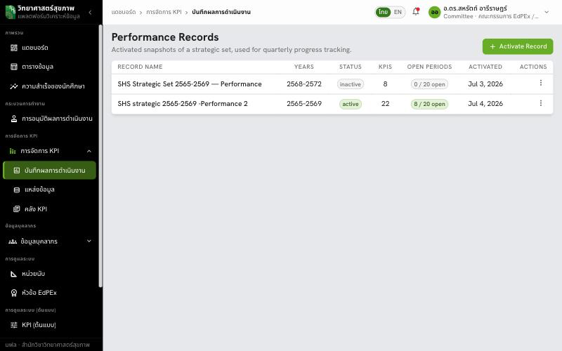

| คอลัมน์ | ความหมาย |
|---|---|
| **Record Name** | ชื่อ Record (หนึ่ง Record = สำเนาของชุดยุทธศาสตร์หนึ่งชุด ใช้ติดตามผลรายไตรมาส) |
| **Years** | ช่วงปีของ Record |
| **Status** | **active** ใช้งานอยู่ · **inactive** พักไว้ · **completed** จบแล้ว |
| **KPIs** | จำนวน KPI ใน Record |
| **Open Periods** | จำนวนไตรมาสที่เปิดให้กรอก จากทั้งหมด 20 (5 ปี × 4 ไตรมาส) |

#### สร้าง Record: Activate Record

1. กดปุ่ม **Activate Record** มุมขวาบน
2. ช่อง **Strategic set** เลือกชุดยุทธศาสตร์ (เลือกได้เฉพาะชุดที่สถานะ Active ในคลัง KPI ดูหัวข้อ 1.1)
3. ช่อง **Record name** ตั้งชื่อ (ไม่บังคับ ถ้าเว้นว่างจะใช้ชื่อของชุด)
4. กด **Activate** ระบบถ่ายสำเนา KPI และตัวชี้วัดของชุดนั้นมาเป็น Record แล้วพาไปหน้า Record

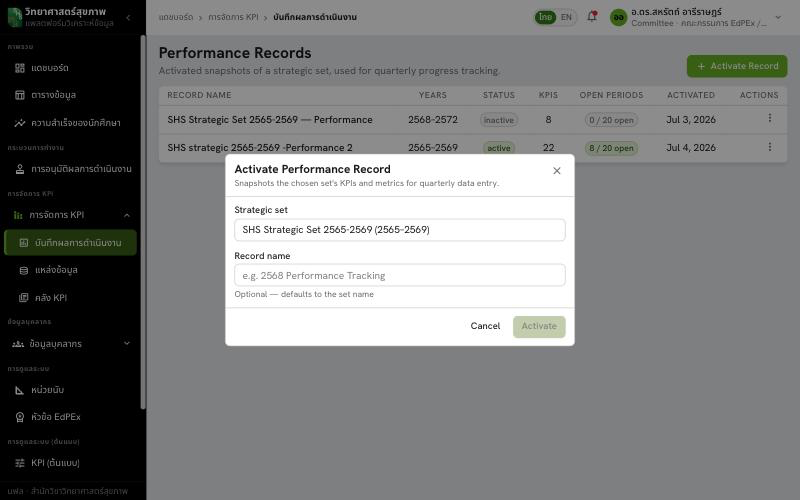

> ⚠️ KPI ใน Record **แก้นิยามไม่ได้** ถ้าต้องแก้ ให้แก้ที่ **คลัง KPI** (ส่วน 1) เมื่อบันทึก ระบบอัปเดต Record ที่ active ให้เอง ถ้ายังไม่เห็นการเปลี่ยนแปลง ให้กด **Sync from Library** (ความคืบหน้าที่กรอกไว้แล้วไม่หาย)

#### เปิด-ปิดรอบบันทึก: Recording periods

1. กดปุ่ม **⋮** ท้ายแถวของ Record แล้วเลือก **Recording periods**

   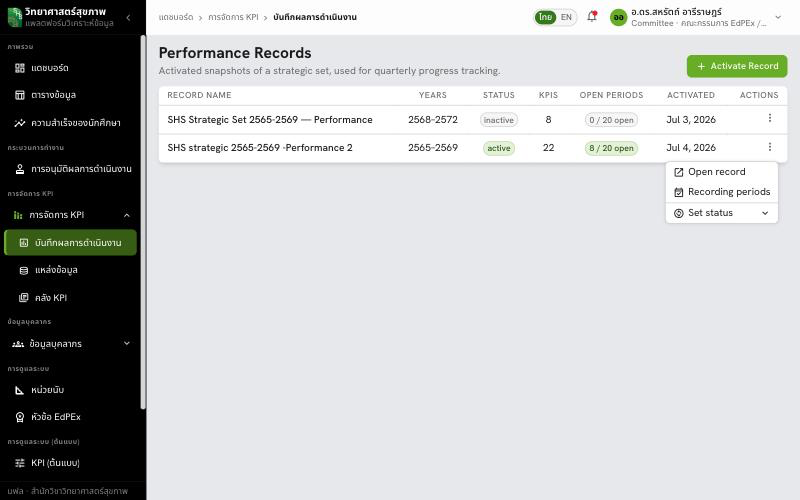

2. แต่ละปี (**Year 1** ถึง **Year 5**) มีปุ่ม Q1–Q4 ปุ่มสีเขียวเข้ม = **Open** (กรอกได้) ปุ่มสีเทา = **Closed**
3. กดทีละไตรมาส หรือกด **Open Year** / **Close Year** เพื่อเปิด-ปิดทั้งปี
4. กด **Save Periods**

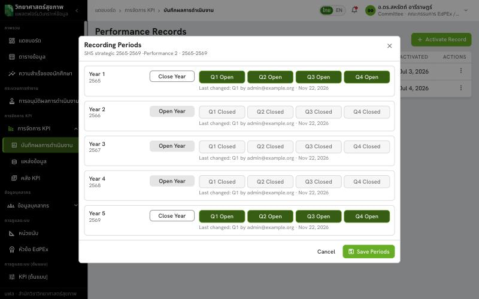

> ⚠️ ไตรมาสที่ปิดอยู่ ผู้ใช้กรอกไม่ได้ ระบบจะแจ้งว่า "…is closed for recording. Ask an admin to open it to enter progress." และข้อมูลจากแหล่งข้อมูลจะไม่ทับค่าของรอบที่ปิด (ตามหัวข้อ 4.6)
> เอาเมาส์ชี้ช่องไตรมาส เพื่อดูว่าใครเปิดหรือแก้ล่าสุดเมื่อไร

#### เปลี่ยนสถานะ Record: Set status

กด **⋮** → **Set status** → เลือก **active** / **inactive** / **completed** แล้วยืนยัน
ถ้าไม่ใช่ **active** ระบบจะหยุดการกรอก การ Sync และการรับค่าจากแหล่งข้อมูล จนกว่าจะตั้งเป็น **active** อีกครั้ง

#### ปุ่มบนหน้า Record (ผู้ดูแลระบบ)

| ปุ่ม | ทำอะไร | ใช้เมื่อ |
|---|---|---|
| **Sync from Library** | ดึงการแก้ไข KPI จากคลัง KPI เข้ามาใหม่ทั้ง Record (ความคืบหน้าที่กรอกไว้ไม่หาย) | แก้ KPI ในคลังแล้วยังไม่เห็นการเปลี่ยนแปลง (ปกติระบบอัปเดตให้เองเมื่อบันทึก) |
| **Recompute from Data Sources** | คำนวณค่าที่แหล่งข้อมูลป้อนให้ใหม่ทั้ง Record | สงสัยว่าค่าไม่ตรงกับข้อมูลต้นทาง (ปกติระบบคำนวณเองเมื่อข้อมูลเปลี่ยน) |

ทั้งสองปุ่มใช้ได้เฉพาะ Record ที่ **active**

### 5.2 เปิด KPI ที่ต้องกรอก

1. เมนู **บันทึกผลการดำเนินงาน** แล้วคลิกชื่อ Record ที่ **active** (หรือ **⋮** → **Open record**)
2. แถบด้านบนบอกไตรมาสที่เปิด เช่น "Recording open: Y1 Q1, Q2, Q3, Q4"
3. เลือกตัวกรอง **Year**, **Quarter**, **KPI Type** (**Strategic** / **Operational** / **Routine**) และเลือกคณะกรรมการทางซ้าย (ช่อง **Search committees…**)
4. หาแถว KPI แล้วกดปุ่มท้ายแถว

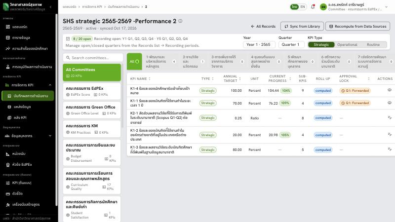

| คอลัมน์ | ความหมาย |
|---|---|
| **KPI Name** | ชื่อ KPI |
| **Annual Target** / **Unit** | เป้าหมายของปีที่เลือก และหน่วย |
| **Current Progress** | ค่าล่าสุดของปี พร้อม % เทียบเป้ารายปี |
| **Sub-KPIs** | จำนวนตัวชี้วัดย่อย |
| **Roll-up** | **computed** = ค่ามาจากตัวชี้วัดย่อยหรือแหล่งข้อมูล ไม่ได้พิมพ์เอง |
| **Approval Lock** | สถานะการส่งอนุมัติของไตรมาสที่เลือก เช่น *Q1: Forwarded* |
| **Actions** | ไอคอนดินสอ = **Record progress** (กรอกได้) · ไอคอนตา = **View progress** (ถูกล็อก ดูได้อย่างเดียว) |

### 5.3 กรอกความคืบหน้ารายไตรมาส

กดไอคอนท้ายแถว หน้าต่าง KPI จะเปิดทางขวา

1. เลือกแท็บปี **Year 1 · 2565** … **Year 5 · 2569** แล้วเลือกแท็บไตรมาส **Quarter 1–4**
   ใต้แท็บมีข้อความ "Open this year: Q1, Q2, …" บอกไตรมาสที่กรอกได้
2. ส่วน **Q1 Data Entry** บอกเป้าหมายของไตรมาส (**Annual Target** หรือ **Cumulative Target** ตามที่ KPI ตั้งไว้)
3. กรอกค่า มี 2 แบบ ขึ้นกับ KPI
   - **KPI ที่มี Variable** กรอก **Variable 1** (และ **Variable 2** ถ้าเป็นร้อยละหรืออัตราส่วน) ระบบคำนวณ **Computed value (Cumulative)** ให้ เช่น 96 และ 120 ได้ 80%
   - **KPI ที่ไม่มี Variable** กรอก **Progress value (Cumulative)** ตรง ๆ
   - ค่าเป็นค่า**สะสม**ถึงสิ้นไตรมาสนั้น
4. กรอก **Issue / difficulty** (ปัญหาหรืออุปสรรค) และ **Solution** (แนวทางแก้ไข) **ต้องกรอกทั้งสองช่อง** (มีเครื่องหมาย *Required)
5. กด **Save Q1** ระบบบันทึกและแจ้งว่า "Progress saved"

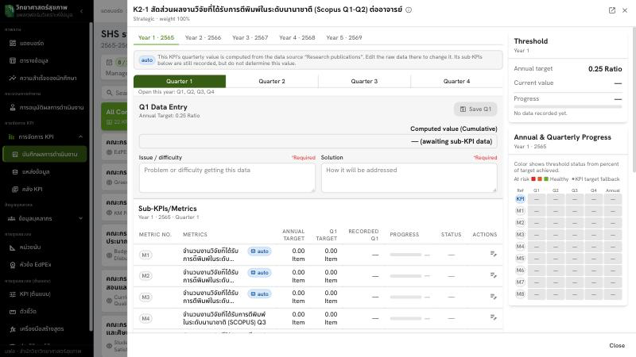

- ถ้าไตรมาสก่อนหน้ามีข้อมูลแล้ว ระบบเติมค่าและข้อความให้เป็น**ร่าง** (ยังไม่บันทึก) ตรวจและแก้ แล้วกด **Save** เอง
- การ์ด **Threshold** ด้านขวาแสดง **Annual target**, **Current value**, **Progress** (ร้อยละของเป้า) และป้ายสถานะ เช่น **On Target**
- ตาราง **Annual & Quarterly Progress** ใช้สีบอกสถานะ จาก **At risk** (แดง) ถึง **Healthy** (เขียว) ตามเกณฑ์สีของ KPI นั้น

### 5.4 KPI ที่ไม่ได้กรอกค่าเอง

บาง KPI มีป้าย **auto** ที่หัวหน้าต่าง แปลว่าค่าถูกคำนวณจากที่อื่น

#### ก. KPI แม่ ที่มีตัวชี้วัดย่อย (Sub-KPIs)

- ช่อง **Computed value (Cumulative)** เป็นอ่านอย่างเดียว ขึ้น "— (awaiting sub-KPI data)" จนกว่าตัวชี้วัดย่อยจะมีข้อมูล
- ให้กรอกที่ตารางด้านล่าง **Sub-KPIs/Metrics** กดไอคอนท้ายแถวตัวชี้วัด หน้าต่าง **Quarterly progress** จะเปิด (มีการ์ด **Threshold Setting** ของไตรมาสนั้น) กรอกค่า **Issue** **Solution** แล้วกด **Save Q1** เหมือนหัวข้อ 5.3 ถ้าตัวชี้วัดย่อยป้อนค่าจากแหล่งข้อมูล จะแก้ได้เฉพาะ **Issue** และ **Solution**
- **Issue / difficulty** และ **Solution** ของ KPI แม่ ยังต้องกรอกเองเหมือนเดิม

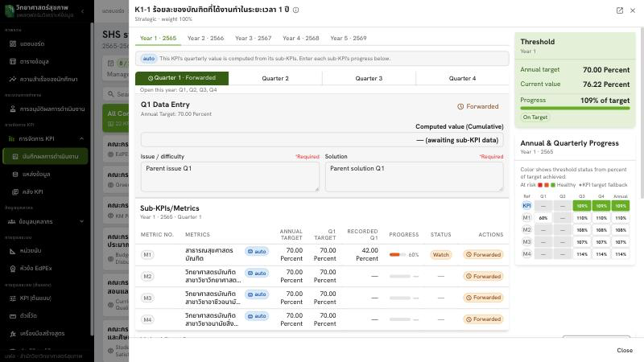

#### ข. KPI ที่ป้อนค่าจากแหล่งข้อมูล (ส่วน 4)

- ป้ายข้อความ "…computed from the data source …" บอกชื่อแหล่งข้อมูลที่ป้อนค่าให้
- ค่าแก้เองไม่ได้ ถ้าจะเปลี่ยนค่า ให้แก้ที่**ข้อมูลดิบ**
- **Issue / difficulty** และ **Solution** ยังต้องกรอก แล้วกด **Save Q1** ตามปกติ
- ด้านล่างของหน้าต่างมีส่วน **Linked Data Sources** ให้เพิ่มหรือแก้ข้อมูลดิบ**ที่นี่ได้เลย** ไม่ต้องกลับไปหน้าแหล่งข้อมูล

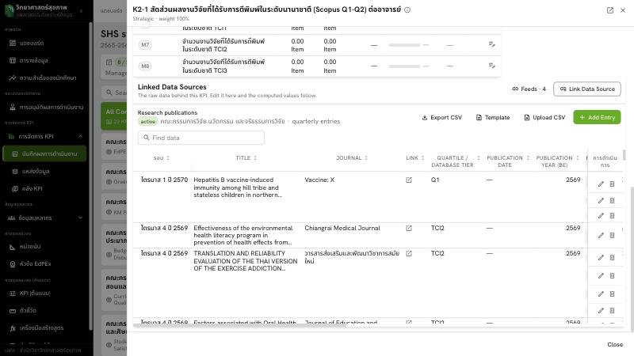

| ปุ่ม / ช่อง | ทำอะไร |
|---|---|
| **Export CSV**, **Template**, **Upload CSV**, **+ Add Entry** | เหมือนที่หน้าแหล่งข้อมูล (หัวข้อ 2.5) |
| **Find data** | ค้นหาแถวในตาราง |
| **Feeds · 4** | เอาเมาส์ชี้ เพื่อดูว่าข้อมูลนี้ป้อนค่าให้ตัวชี้วัดไหนบ้าง |
| **Link Data Source** | เชื่อมแหล่งข้อมูลกับ KPI นี้ (เฉพาะผู้ดูแลระบบ) ผลเหมือนการเชื่อมโยงในส่วน 4 และมีผลกับทุก Record |

> ถ้าแหล่งข้อมูลยังไม่มีคอลัมน์ ระบบแจ้ง "This data source has no columns…" ให้ไปกำหนดคอลัมน์ที่หน้าแหล่งข้อมูลก่อน (ส่วน 3)

### 5.5 ส่งอนุมัติ

เมื่อกด **Save** และข้อมูลครบแล้ว ผู้กรอกส่งให้หัวหน้าตรวจ

1. ผู้กรอกกด **Submit to Committee lead** (ปุ่มกดได้เมื่อบันทึกข้อมูลครบแล้ว ถ้ายังไม่ได้ Save ระบบแจ้ง "Save the current quarter data before submitting.")
2. หัวหน้าคณะกรรมการ (*Committee Lead*) ตรวจ แล้วกด **Forward to counselor** หรือ **Send back**
3. ที่ปรึกษา (*Counselor*) ตรวจ แล้วกด **Approve** หรือ **Reject**

| ปุ่ม | ใครกด | จากสถานะ | ไปสถานะ | ต้องใส่ Note |
|---|---|---|---|---|
| **Submit to Committee lead** | ผู้กรอก | Draft / Returned | Submitted | ไม่ |
| **Send back** | Committee Lead | Submitted | Returned | **ต้อง** |
| **Forward to counselor** | Committee Lead | Submitted | Forwarded | ไม่ |
| **Reject** | Counselor | Forwarded | Submitted | **ต้อง** |
| **Approve** | Counselor | Forwarded | Approved (ล็อก) | ไม่ มีหน้าต่างยืนยัน |
| **Reverse** | ผู้ดูแลระบบ | Approved | Returned | — |

- **Send back** และ **Reject** เปิดหน้าต่างให้พิมพ์ **Note to recipient** (อย่างน้อย 3 ตัวอักษร) ว่าต้องแก้อะไร แล้วกดปุ่มชื่อเดียวกันอีกครั้ง
- **Approve** แสดงหน้าต่าง "Approve KPI performance?" และเตือนว่า "Approval will lock this KPI and all of its metrics for the selected quarter."
- สถานะ **Submitted**, **Forwarded**, **Approved** คือสถานะ**ล็อก** ผู้กรอกแก้ไม่ได้ ปุ่ม Save หายไปและมีป้ายสถานะแทน (หัวหน้าแก้ได้ตอน Submitted และที่ปรึกษาแก้ได้ตอน Forwarded)
- ถ้าถูก **Send back** สถานะเป็น **Returned** ผู้กรอกแก้แล้วกด **Submit to Committee lead** ใหม่
- เมื่อ **Approved** แล้วต้องการแก้ ให้ผู้ดูแลระบบกด **Reverse**

### 5.6 หน้า Performance Approvals

หน้านี้รวมงานรอตรวจ/รออนุมัติของทั้งไตรมาสไว้ที่เดียว เมนูซ้ายชื่อ **การอนุมัติผลการดำเนินงาน**

1. เลือก **Performance record**, **Year** และ **Quarter** ที่ต้องการ
2. เลือกแท็บสถานะ **Draft** / **Submitted** / **Returned** / **Forwarded** / **Approved** / **All** (ตัวเลขบอกจำนวน KPI)

   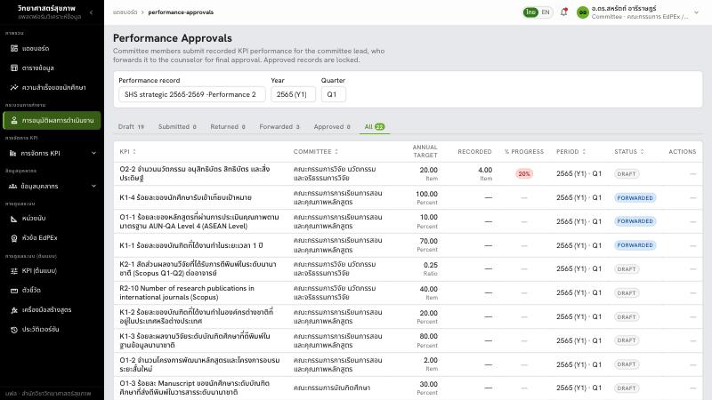

3. ตารางมีคอลัมน์ **KPI**, **Committee**, **Annual Target**, **Recorded**, **% Progress**, **Period**, **Status**, **Actions**
4. คลิกแถวเพื่อเปิดรายละเอียดทางขวา: **Target vs actual**, **Issue & solution**, **Annual & Quarterly Progress**

   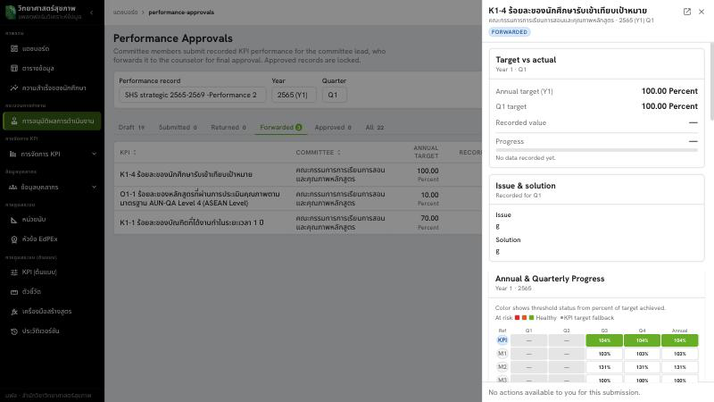

5. ปุ่มด้านล่างลิ้นชัก และปุ่มท้ายแถว มีเฉพาะที่คุณทำได้ตามตำแหน่ง ปุ่มเดินหน้า (**Submit**, **Forward**, **Approve**) เป็นสีเขียว ปุ่มถอยกลับ (**Send back**, **Reject**) เป็นสีแดง
6. ถ้าไม่มีปุ่ม จะเห็นข้อความ "No actions available to you for this submission."

### 5.7 แก้ปัญหา

| อาการ | สาเหตุ | วิธีแก้ |
|---|---|---|
| **Save Q1** กดไม่ได้ | **Issue / difficulty** หรือ **Solution** ยังว่าง หรือ Variable ยังกรอกไม่ครบ | กรอกช่องที่มี *Required ให้ครบ |
| แจ้ง "…is closed for recording" | ไตรมาสนั้นปิดอยู่ | ขอผู้ดูแลระบบเปิดที่ **Recording periods** |
| **Submit to Committee lead** กดไม่ได้ | ยังไม่ได้ Save หรือมีการแก้ที่ยังไม่บันทึก | กด **Save** ก่อน |
| ไม่มีช่องกรอก เห็นป้าย *Submitted* / *Forwarded* / *Approved* | ข้อมูลถูกล็อก | ขอให้หัวหน้า **Send back** หรือผู้ดูแลระบบ **Reverse** |
| ช่องค่า (Computed value) แก้ไม่ได้ | ค่ามาจากตัวชี้วัดย่อยหรือแหล่งข้อมูล | แก้ที่ตัวชี้วัดย่อย หรือข้อมูลดิบ |
| **Sync from Library** / **Recompute from Data Sources** กดไม่ได้ | Record ไม่ได้เป็น **active** | **Set status** เป็น **active** |
| ค่า KPI ไม่ตรงกับข้อมูลดิบ | อาจติดแถว "ไม่ครบ" หรือรอบปิด (ส่วน 4.6) | ดูเช็กลิสต์ในภาคผนวก 6.3 หรือกด **Recompute from Data Sources** |

---

## 6. ภาคผนวก

### 6.1 คำศัพท์

| คำ | ความหมาย |
|---|---|
| แหล่งข้อมูล | ตารางเก็บข้อมูลดิบของคณะกรรมการ |
| คอลัมน์ | ช่องหนึ่งช่องของตาราง |
| รายการข้อมูล / แถว | ข้อมูลหนึ่งรายการ |
| รอบ | ปี (และไตรมาส) ที่ข้อมูลนี้เป็นของ ใช้ปี พ.ศ. |
| ความถี่ | แหล่งข้อมูลเก็บรายไตรมาสหรือรายปี |
| แถวไม่ครบ | แถวที่ยังเว้นช่องจำเป็นว่าง ระบบไม่นับใน KPI |
| การแมป | กติกาที่บอกว่านับข้อมูลอย่างไร |
| ตัวตั้ง / ตัวหาร | ตัวตั้ง ÷ ตัวหาร = ร้อยละหรืออัตราส่วน |
| ค่าที่ระบบคำนวณ | ค่า KPI ที่มาจากแหล่งข้อมูล ผู้ใช้แก้เองไม่ได้ |
| เป็นหลักฐานเท่านั้น | เชื่อมโยงไว้ แต่ไม่ป้อนค่า |
| เก็บถาวร | เลิกเก็บข้อมูลเพิ่ม แต่ข้อมูลยังแสดงอยู่ |
| Record (บันทึกผลการดำเนินงาน) | สำเนาของชุดยุทธศาสตร์ ใช้ติดตามผลรายไตรมาส |
| Recording period (รอบบันทึก) | ไตรมาสที่เปิดให้กรอกผล (Open) หรือปิด (Closed) |
| Cumulative | ค่าสะสมถึงสิ้นไตรมาสนั้น |
| Threshold | เกณฑ์สี บอกว่า KPI อยู่ในระดับ At risk หรือ Healthy |
| Approval Lock | การล็อกข้อมูลเมื่อส่งอนุมัติ (Submitted / Forwarded / Approved) |
| Submit / Forward / Approve | ส่งตรวจ / ส่งต่อให้ที่ปรึกษา / อนุมัติขั้นสุดท้าย |
| Send back / Reject | ส่งกลับให้แก้ (ต้องใส่ Note) |
| ชุดยุทธศาสตร์ (Strategic Set) | แผน 5 ปีหนึ่งชุด เก็บ KPI ทั้งหมดของช่วงปีนั้น |
| Draft (ฉบับร่าง) | KPI ที่ยังไม่เคยบันทึก ยังไม่เข้า Record |
| Clone | สร้างชุดใหม่โดยคัดลอกจากชุดเดิม |
| KPI ย่อย (Sub-KPI / Metric) | ส่วนประกอบของ KPI เช่น แยกตามสาขาวิชา |
| น้ำหนัก (Weight) | สัดส่วนความสำคัญของ KPI หรือ KPI ย่อย ใช้ในการรวมแบบถ่วงน้ำหนัก |
| เพดาน 5 ปี | ค่าสูงสุดที่เป้าหมายแต่ละปีห้ามเกิน |
| ตรรกะการคำนวณ | วิธีรวมค่า KPI ย่อยขึ้นเป็นค่า KPI แม่ |
| เกณฑ์ตามเป้า / เฝ้าระวัง | % ของเป้าหมายที่ใช้แบ่งสี ปกติ / เฝ้าระวัง / At risk |

### 6.2 ข้อความแจ้งเตือนที่พบบ่อย

| ข้อความ | สาเหตุ | วิธีแก้ |
|---|---|---|
| ทุกคอลัมน์ต้องมีชื่อที่แสดง | มีการ์ดคอลัมน์ที่ยังไม่ตั้งชื่อ | ตั้งชื่อ หรือลบการ์ดนั้น |
| คอลัมน์ "…" เป็นแบบตัวเลือก จึงต้องมีอย่างน้อยหนึ่งตัวเลือก | ยังไม่ใส่ตัวเลือก | ใส่ตัวเลือก คั่นด้วย , |
| ตั้งให้กรอกได้หลายค่าได้เพียงคอลัมน์เดียว | ติ๊ก "กรอกได้หลายค่า" มากกว่าหนึ่งคอลัมน์ | เหลือไว้คอลัมน์เดียว |
| … กรอกด้วยสัดส่วนได้เฉพาะเมื่อเป็นคอลัมน์ตัวเลข | ติ๊กสัดส่วนในคอลัมน์ที่ไม่ใช่ตัวเลข | เปลี่ยนประเภทเป็นตัวเลข หรือเอาติ๊กออก |
| ต้องเป็นปี พ.ศ. 4 หลัก เช่น 2569 | กรอกปีไม่ครบ 4 หลัก | กรอกปี พ.ศ. 4 หลัก |
| … ซึ่งดูเหมือนปี ค.ศ. — ปี พ.ศ. คือ … | กรอกปี ค.ศ. | บวก 543 |
| ต้องเป็นวันที่ เช่น 15/03/2569 | รูปแบบวันที่ผิด | กรอก วว/ดด/ปปปป (พ.ศ.) |
| ต้องระบุ "…" | ช่องจำเป็นยังว่าง | กรอกให้ครบ |
| ไฟล์นี้ใหญ่กว่า 2 MB | ไฟล์ CSV ใหญ่เกิน | แบ่งไฟล์เป็นหลายชุด |
| แถวหัวตารางของไฟล์นี้ไม่ตรงกับแหล่งข้อมูลนี้ | แก้หัวตารางในไฟล์ หรือคอลัมน์เปลี่ยนไปแล้ว | ดาวน์โหลด **แม่แบบ** ใหม่ แล้วย้ายข้อมูลไปใส่ |
| เพิ่มอย่างน้อยหนึ่งเงื่อนไข — ถ้าไม่มี คำตอบจะเป็น 100% เสมอ | ตั้งร้อยละคอลัมน์เดียว แต่ไม่มีเงื่อนไขตัวตั้ง | เพิ่มเงื่อนไขตัวตั้ง หรือใช้สองคอลัมน์ |
| เลือกอย่างน้อยหนึ่งตำแหน่ง — ไม่เช่นนั้นไม่มีตัวหาร | ตัวหารเป็นจำนวนบุคลากร แต่ไม่ได้เลือกตำแหน่ง | ติ๊กอย่างน้อย 1 ตำแหน่ง |
| Year n Quarter n is closed for recording. Ask an admin to open it to enter progress. | ไตรมาสนั้นปิดอยู่ | ขอผู้ดูแลระบบเปิดที่ Recording periods |
| เป้าหมายปีที่ n (…) ต้องไม่เกินเป้าหมาย 5 ปี (…) | เป้าหมายปีนั้นสูงกว่าเพดาน | ลดเป้าปีนั้น หรือปรับเพดาน (ส่วน 1.5) |
| ต้องระบุชื่อตัวแปร 1 (ตัวตั้ง) | ยังไม่ได้ตั้งชื่อตัวแปรของ KPI | กรอกชื่อตัวแปร 1 (และตัวแปร 2 เมื่อหน่วยเป็น Percent / Ratio) |
| Can't delete: an active performance record already has recorded progress… | KPI มีผลที่บันทึกแล้วใน Record ที่ active | ปรับหรือปิด Record นั้นก่อน (ส่วน 1.2) |
| Save the parent KPI before adding sub-KPIs | KPI แม่ยังมีการแก้ที่ไม่ได้บันทึก | กด บันทึกการเปลี่ยนแปลง ก่อน |
| At most 500 KPIs per batch | Batch Add เกิน 500 แถว | แบ่งเป็นหลายชุด |
| Save the current quarter data before submitting. | ยังไม่ได้บันทึกก่อนส่ง | กด Save Q ก่อน แล้วกด Submit to Committee lead |
| No actions available to you for this submission. | ตำแหน่งของคุณไม่มีปุ่มสำหรับสถานะนี้ | รอขั้นตอนของผู้อื่น หรือติดต่อผู้ดูแลระบบ |

### 6.3 คำถามที่พบบ่อย

**ลบคอลัมน์แล้ว ข้อมูลหายไหม?**
ระบบซ่อนค่าของคอลัมน์นั้น ถ้าคอลัมน์ถูกใช้ในการเชื่อม KPI ให้ตรวจการเชื่อมโยงก่อนลบ

**เปลี่ยนชื่อคอลัมน์ได้ไหม ข้อมูลเดิมจะหายหรือเปล่า?**
ได้ และข้อมูลเดิมอยู่ครบ

**เปลี่ยนความถี่ (รายไตรมาส/รายปี) ภายหลังได้ไหม?**
ไม่ได้ถ้ามีข้อมูลแล้ว

**ติ๊ก "จำเป็น" ภายหลัง แถวเก่าจะกลายเป็นไม่ครบไหม?**
ไม่ แถวเก่าที่บันทึกไว้แล้วยังนับใน KPI ตามเดิม ธงไม่ครบใช้กับแถวที่บันทึกหลังจากนั้น

**ค่าใน KPI ไม่เปลี่ยน ทั้งที่เพิ่มข้อมูลแล้ว**
ตรวจตามลำดับ
1. แถวนั้นมีป้าย **ไม่ครบ** หรือไม่ (ถ้ามี ยังไม่ถูกนับ)
2. แท็บ **KPI ที่เชื่อมโยง** มีการเชื่อมโยงของ KPI นั้นหรือไม่ และไม่ใช่ **เป็นหลักฐานเท่านั้น**
3. รอบ (ปี/ไตรมาส) ของแถวตรงกับเงื่อนไขที่ตั้งไว้หรือไม่
4. รอบนั้นปิดการบันทึก หรือไตรมาสนั้นอยู่ระหว่างตรวจ/อนุมัติหรือไม่ ระบบจะไม่ทับค่า

**ค่าที่ระบบคำนวณผิด**
แก้ที่ข้อมูลต้นทาง (เพิ่ม/แก้แถว) หรือแก้วิธีนับที่ปุ่ม **แก้ไขการเชื่อมโยง** ระบบคำนวณใหม่ทันทีที่บันทึก

**แก้ KPI ในคลังแล้ว Record เปลี่ยนตามไหม?**
เปลี่ยนตามเมื่อกดบันทึก (เฉพาะ Record ที่ active) ความคืบหน้าที่กรอกไว้แล้วไม่หาย ถ้ายังไม่เห็นให้กด **Sync from Library** ที่หน้า Record

**Clone ชุดเดิมคัดลอกอะไรบ้าง?**
หมวดหมู่ KPI KPI ย่อย เป้าหมายรายปี และสูตรที่เชื่อมไว้ KPI ที่ยังเป็น Draft จะยังเป็น Draft

**ทำไมไม่เห็น KPI ใหม่ในหน้าบันทึกผล?**
KPI ยังเป็น Draft ให้เปิด KPI นั้นแล้วกด **บันทึกการเปลี่ยนแปลง** อย่างน้อยหนึ่งครั้ง และตรวจว่า Record เป็น **active**

**ส่งอนุมัติแล้วแก้ได้ไหม?**
ไม่ได้ สถานะ Submitted, Forwarded และ Approved ล็อกข้อมูล ให้หัวหน้า **Send back** (หรือที่ปรึกษา **Reject**) ก่อน ถ้าอนุมัติแล้วต้องให้ผู้ดูแลระบบ **Reverse**

**ทำไมกรอกไม่ได้ทั้งที่เห็นหน้า KPI?**
ตรวจ 4 อย่าง: ไตรมาสนั้นเปิดอยู่ไหม (Recording periods) · Record เป็น active ไหม · ข้อมูลถูกล็อกจากการส่งอนุมัติไหม · ค่านั้นถูกคำนวณจากตัวชี้วัดย่อยหรือแหล่งข้อมูลไหม

**ไม่เห็นปุ่ม จัดการคอลัมน์ หรือ เชื่อมโยง KPI**
บัญชีของคุณต้องเป็นผู้ดูแลระบบ หรือเลขานุการของคณะกรรมการเจ้าของแหล่งข้อมูลนั้น
