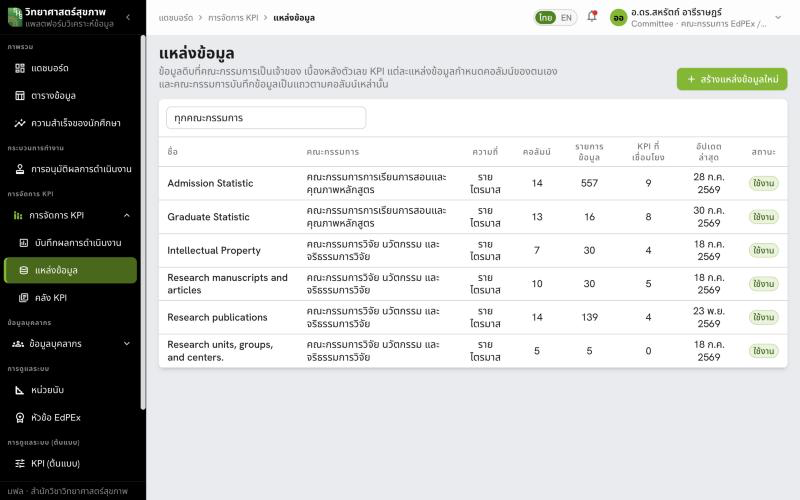
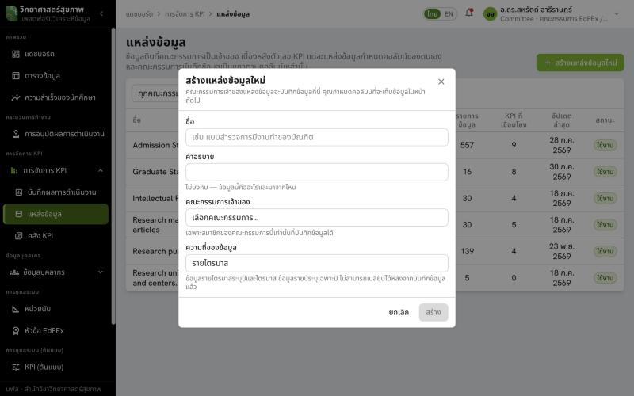
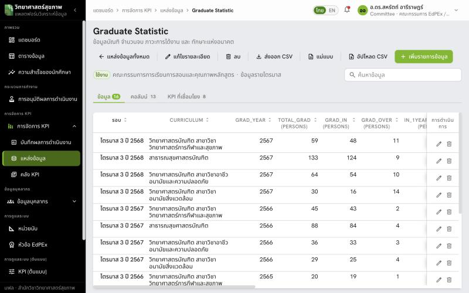
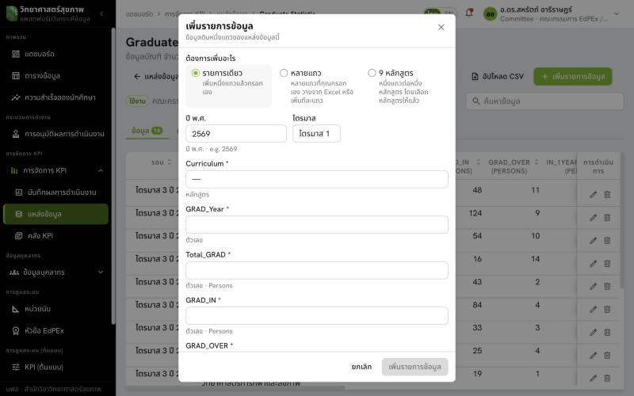
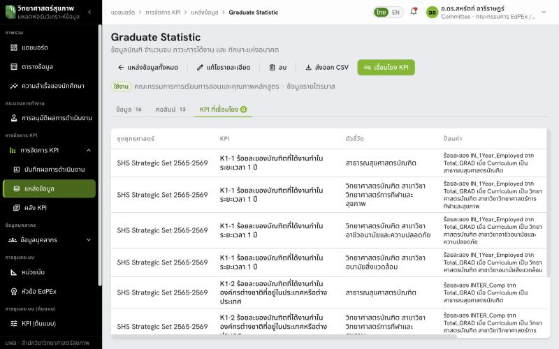
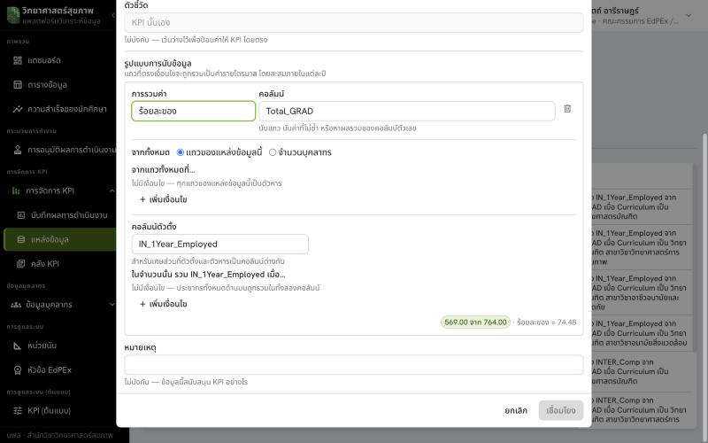

# คู่มือใช้งาน: แหล่งข้อมูล คอลัมน์ และการเชื่อมโยง KPI

คู่มือนี้สอนทีละขั้นตอน สำหรับผู้ใช้ที่ไม่ใช่สายเทคนิค
ชื่อปุ่มและชื่อช่องในคู่มือ เขียนตรงกับที่เห็นบนหน้าจอ ตัวอักษร**หนา**คือสิ่งที่คุณต้องกดหรือเลือก

**สารบัญ**

- [0. อ่านก่อน](#0-อ่านก่อน)
- [1. จัดการแหล่งข้อมูล](#1-จัดการแหล่งข้อมูล)
- [2. แก้ไขคอลัมน์](#2-แก้ไขคอลัมน์)
- [3. เชื่อมโยง KPI](#3-เชื่อมโยง-kpi)
- [4. ภาคผนวก](#4-ภาคผนวก)

---

## 0. อ่านก่อน

### แหล่งข้อมูลคืออะไร

**แหล่งข้อมูล** คือตารางเก็บข้อมูลดิบของคณะกรรมการ เหมือนไฟล์ Excel หนึ่งไฟล์ในระบบ
เช่น "แบบสำรวจการมีงานทำของบัณฑิต" หรือ "รายชื่อโครงการบริการวิชาการ"

ข้อมูลในตารางนี้ใช้คำนวณค่า KPI ให้อัตโนมัติ คุณจึงไม่ต้องคิดเลขเองแล้วพิมพ์ใส่ KPI

### ภาพรวม 3 ขั้นตอน

| ขั้น | ทำอะไร | อยู่ในหัวข้อ |
|---|---|---|
| 1 | สร้างแหล่งข้อมูล (ตั้งชื่อ เลือกคณะกรรมการ เลือกความถี่) | [1](#1-จัดการแหล่งข้อมูล) |
| 2 | กำหนดคอลัมน์ (ตารางมีช่องอะไรบ้าง) แล้วบันทึกข้อมูล | [2](#2-แก้ไขคอลัมน์) |
| 3 | เชื่อมโยง KPI (บอกระบบว่าจะนับข้อมูลอย่างไร) | [3](#3-เชื่อมโยง-kpi) |

> **ลำดับสำคัญ** ต้องมีคอลัมน์ก่อน จึงจะบันทึกข้อมูลได้ และต้องมีข้อมูลหรืออย่างน้อยมีคอลัมน์ จึงจะตั้งเงื่อนไขการนับได้

### ใครทำอะไรได้

| งาน | ผู้ดูแลระบบ | กรรมการและเลขานุการ (*Committee and Secretary*) ของคณะกรรมการเจ้าของ | กรรมการอื่น (สมาชิกคณะกรรมการเจ้าของ) |
|---|:---:|:---:|:---:|
| สร้าง / แก้ไขรายละเอียด / ลบแหล่งข้อมูล | ✅ | — | — |
| จัดการคอลัมน์ | ✅ | ✅ | — |
| เชื่อมโยง KPI | ✅ | ✅ (เฉพาะ KPI ของคณะกรรมการที่ตัวเองสังกัด) | — |
| เพิ่ม / แก้ไขรายการข้อมูล | ✅ | ✅ | ✅ |
| ดูข้อมูลและส่งออก CSV | ✅ | ✅ | ✅ |

ถ้าไม่เห็นปุ่มที่คู่มือบอก แปลว่าบัญชีของคุณไม่มีสิทธิ์ทำขั้นตอนนั้น ให้ติดต่อผู้ดูแลระบบ

---

## 1. จัดการแหล่งข้อมูล

### 1.1 สร้างแหล่งข้อมูลใหม่ (ผู้ดูแลระบบ)

1. เมนูด้านซ้าย เลือก **การจัดการ KPI** แล้วเลือก **แหล่งข้อมูล**
2. กดปุ่ม **สร้างแหล่งข้อมูลใหม่** มุมขวาบน

   

3. กรอกในหน้าต่างที่เปิดขึ้น

   | ช่อง | ใส่อะไร | หมายเหตุ |
   |---|---|---|
   | **ชื่อ** | ชื่อที่สื่อความหมาย เช่น *แบบสำรวจการมีงานทำของบัณฑิต* | ต้องกรอก |
   | **คำอธิบาย** | ข้อมูลนี้คืออะไร มาจากไหน | ไม่บังคับ |
   | **คณะกรรมการเจ้าของ** | คณะกรรมการที่รับผิดชอบข้อมูลนี้ | เฉพาะสมาชิกของคณะกรรมการนี้เท่านั้นที่บันทึกข้อมูลได้ |
   | **ความถี่ของข้อมูล** | **รายไตรมาส** (ระบุปี + ไตรมาส) หรือ **รายปี** (ระบุเฉพาะปี) | ⚠️ เปลี่ยนไม่ได้หลังมีข้อมูลแล้ว คิดให้ดีก่อน |

   

4. กดปุ่ม **สร้าง** ระบบแจ้งว่า "สร้างแหล่งข้อมูล "…" แล้ว"
5. ระบบพาคุณไปหน้ารายละเอียด ซึ่งยังไม่มีคอลัมน์ ไปต่อที่ [หัวข้อ 2](#2-แก้ไขคอลัมน์)

### 1.2 แก้ไขรายละเอียด หรือเก็บถาวร (ผู้ดูแลระบบ)

1. เปิดแหล่งข้อมูลที่ต้องการ
2. กดปุ่ม **แก้ไขรายละเอียด** ด้านบน
3. แก้ชื่อ คำอธิบาย หรือคณะกรรมการเจ้าของ แล้วกด **บันทึก**
4. ช่อง **สถานะ** เลือก **เก็บถาวร** ได้ ถ้าเลิกเก็บข้อมูลนี้แล้ว
   แหล่งข้อมูลที่เก็บถาวรยังแสดงอยู่ แต่บอกให้รู้ว่าไม่มีการเก็บข้อมูลเพิ่ม

> การแก้ไขรายละเอียดไม่กระทบคอลัมน์และข้อมูลที่บันทึกไว้

### 1.3 ลบแหล่งข้อมูล (ผู้ดูแลระบบ)

> ⚠️ **ลบแล้วกู้คืนไม่ได้** ระบบจะลบทั้งคอลัมน์ ข้อมูลทุกแถว และการเชื่อมโยง KPI ของแหล่งข้อมูลนั้น
> ถ้าแค่เลิกใช้ ให้ใช้ **เก็บถาวร** ในหัวข้อ 1.2 แทน

1. เปิดแหล่งข้อมูล กดปุ่ม **ลบ** (สีแดง)
2. หน้าต่างยืนยันบอกจำนวนข้อมูลและการเชื่อมโยงที่จะหายไป อ่านให้ครบ
3. พิมพ์คำว่า `DELETE THIS DS` ให้ตรงทุกตัวอักษร ในช่องใต้ข้อความ (ช่องนี้และปุ่ม Cancel ยังเป็นภาษาอังกฤษ)
4. กด **ลบแหล่งข้อมูล** (ปุ่มจะกดได้เมื่อพิมพ์ถูกต้อง) ถ้าไม่ต้องการลบ ให้กด **Cancel**

### 1.4 รู้จักหน้ารายละเอียด

หน้ารายละเอียดมี 3 แท็บ ตัวเลขข้างชื่อแท็บคือจำนวนรายการ

| แท็บ | ใช้ทำอะไร |
|---|---|
| **ข้อมูล** | ดู เพิ่ม แก้ไขแถวข้อมูล |
| **คอลัมน์** | ดูว่าตารางมีช่องอะไรบ้าง (กด **จัดการคอลัมน์** เพื่อแก้) |
| **KPI ที่เชื่อมโยง** | ดูว่าข้อมูลนี้ป้อนค่าให้ KPI ตัวไหน (กด **เชื่อมโยง KPI** เพื่อเพิ่ม) |

ปุ่มที่เห็นด้านบนจะเปลี่ยนไปตามแท็บที่เปิดอยู่ และตามสิทธิ์ของคุณ

### 1.5 บันทึกข้อมูลลงแหล่งข้อมูล

ทำได้หลังกำหนดคอลัมน์แล้ว (หัวข้อ 2) มี 2 วิธี

#### วิธี ก. เพิ่มทีละรายการ

1. แท็บ **ข้อมูล** กด **เพิ่มรายการข้อมูล** (ปุ่มเขียวมุมขวาบน)
2. ส่วน **ต้องการเพิ่มอะไร** ปกติเลือก **รายการเดียว**
3. เลือก **ปี พ.ศ.** (4 หลัก เช่น 2569) และ **ไตรมาส** ถ้าเป็นแหล่งข้อมูลรายไตรมาส
4. กรอกค่าในแต่ละคอลัมน์ ช่องที่มีเครื่องหมาย `*` ต้องกรอก ใต้ชื่อช่องบอกประเภทและหน่วย เช่น "ตัวเลข · Persons"
5. ใส่ **หมายเหตุ** ถ้าต้องการ (ไม่บังคับ)
6. กดปุ่ม **เพิ่มรายการข้อมูล** ท้ายหน้าต่าง ระบบแจ้งว่า "บันทึกรายการข้อมูลแล้ว"

ตัวเลือกอื่นในส่วน **ต้องการเพิ่มอะไร**

| ตัวเลือก | ใช้เมื่อ |
|---|---|
| **หลายแถว** | กรอกหลายแถวพร้อมกัน วางจาก Excel หรือเพิ่มทีละแถว ทุกแถวใช้รอบเวลาเดียวกัน |
| **N สาขาวิชา / N หลักสูตร** | ปรากฏเมื่อแหล่งข้อมูลมีคอลัมน์สาขาวิชา/หลักสูตร ระบบสร้างหนึ่งแถวต่อหนึ่งสาขา/หลักสูตรให้ คุณกรอกเฉพาะตัวเลข |

#### วิธี ข. อัปโหลดไฟล์ CSV

เหมาะเมื่อมีข้อมูลจำนวนมากอยู่ใน Excel แล้ว

1. กด **แม่แบบ** (ปุ่มด้านบนของหน้า) เพื่อดาวน์โหลดไฟล์ตัวอย่าง ไฟล์นี้มีหัวตารางที่ถูกต้อง และมีรายการค่าที่ใช้ได้ของแต่ละคอลัมน์
2. เปิดด้วย Excel กรอกข้อมูลทีละแถว **ห้ามแก้แถวหัวตาราง**
3. บันทึกเป็นไฟล์ CSV
4. กด **อัปโหลด CSV** วางไฟล์ หรือกด **เลือกไฟล์ CSV**
5. ระบบตรวจไฟล์และแสดงผลเป็นตาราง แถวที่มีปัญหาขึ้นสถานะ **ผิดพลาด** / **ไม่ครบ** / **ซ้ำ**
6. เลือกวิธีนำเข้า

   | ปุ่ม | ผล |
   |---|---|
   | **นำเข้าเฉพาะที่ครบ** | นำเข้าแถวที่ถูกต้อง ข้ามแถวที่ไม่ครบ |
   | **นำเข้าพร้อมติดธงไม่ครบ** | นำเข้าทุกแถว แถวที่ไม่ครบถูกติดธง แต่ระบบยังไม่นับแถวนั้นใน KPI |

   

> ⚠️ ไฟล์ต้องไม่ใหญ่เกิน 2 MB ถ้าใหญ่กว่านั้น ให้แบ่งนำเข้าทีละชุด
> แถวที่มีข้อผิดพลาดต้องกลับไปแก้ในไฟล์ แล้วอัปโหลดใหม่

#### แถวที่ "ไม่ครบ" คืออะไร

แถวที่ยังเว้นช่องจำเป็นว่างไว้ จะมีป้าย **ไม่ครบ** สีส้ม และ**ไม่ถูกนับใน KPI ใดเลย** จนกว่าจะกรอกครบ
เมื่อกรอกครบแล้วบันทึก ระบบนับให้ทันที
ด้านบนของตารางมีปุ่ม **ไม่ครบ (จำนวน)** กดเพื่อดูเฉพาะแถวเหล่านี้

#### ค้นหา และส่งออก

- ช่อง **ค้นหาข้อมูล** กรองแถวในตาราง
- ปุ่ม **ส่งออก CSV** ดาวน์โหลดข้อมูลทั้งหมดเป็นไฟล์ (ปุ่มนี้ปรากฏเมื่อมีข้อมูลแล้ว)

---

## 2. แก้ไขคอลัมน์

**คอลัมน์** คือช่องของตาราง เช่น "สาขาวิชา" "จำนวนบัณฑิต" "จำนวนที่ได้งานทำ"
ผู้ที่แก้คอลัมน์ได้คือผู้ดูแลระบบ และเลขานุการของคณะกรรมการเจ้าของ

> **ตัวอย่างที่ใช้ตลอดคู่มือ** แหล่งข้อมูล "แบบสำรวจการมีงานทำของบัณฑิต"
> ใช้คำนวณ KPI "ร้อยละบัณฑิตที่ได้งานทำภายใน 1 ปี"
>
> | ชื่อที่แสดง | ประเภท | จำเป็น |
> |---|---|:---:|
> | สาขาวิชา | สาขาวิชา | ✅ |
> | จำนวนบัณฑิตที่สำเร็จการศึกษา | ตัวเลข | ✅ |
> | จำนวนบัณฑิตที่ได้งานทำ | ตัวเลข | ✅ |

### 2.1 เพิ่มคอลัมน์

1. เปิดแท็บ **คอลัมน์** แล้วกดปุ่ม **จัดการคอลัมน์** (ถ้ายังไม่มีคอลัมน์ ปุ่มนี้อยู่กลางหน้าจอด้วย)

   

2. กด **เพิ่มคอลัมน์** ด้านล่าง จะได้การ์ดใหม่ 1 ใบ
3. กรอก

   | ช่อง | ความหมาย |
   |---|---|
   | **ชื่อที่แสดง** | ชื่อหัวคอลัมน์ที่ผู้ใช้เห็น เช่น *จำนวนนักศึกษา* ต้องกรอกทุกคอลัมน์ |
   | **ประเภท** | ชนิดข้อมูล ดูตารางในข้อ 2.2 |
   | **หน่วย** | ปรากฏเฉพาะประเภท **ตัวเลข** เช่น คน บาท ร้อยละ |
   | **จำเป็น** | ติ๊กถ้าต้องกรอกทุกครั้ง ถ้าเว้นว่าง แถวนั้นจะเป็นแถว "ไม่ครบ" |

4. ใต้การ์ดมีข้อความ **เก็บเป็น** ตามด้วยรหัสสั้น ๆ นี่คือ "ชื่อที่ระบบใช้เก็บ" สร้างให้เอง ไม่ต้องกรอก
5. เพิ่มคอลัมน์ให้ครบ แล้วกด **บันทึกคอลัมน์** ระบบแจ้งว่า "บันทึกคอลัมน์แล้ว"

> ถ้าปุ่ม **บันทึกคอลัมน์** กดไม่ได้ ให้ดูข้อความสีแดงใต้รายการ ระบบบอกว่าติดตรงไหน (เช่น ยังไม่ตั้งชื่อ หรือคอลัมน์แบบตัวเลือกยังไม่มีตัวเลือก)

### 2.2 เลือกประเภทให้ถูก

| ประเภท | ใช้เมื่อ | ตัวอย่าง |
|---|---|---|
| **ข้อความ** | พิมพ์อะไรก็ได้ | ชื่อโครงการ |
| **URL** | ลิงก์เว็บ ต้องขึ้นต้น http หรือ https | ลิงก์หลักฐาน |
| **ตัวเลข** | ใช้บวก เฉลี่ย หรือหาร ใน KPI | จำนวนคน จำนวนเงิน |
| **วันที่** | วัน/เดือน/ปี พ.ศ. (วว/ดด/ปปปป) | 15/03/2569 |
| **ตัวเลือก** | เลือกจากรายการที่กำหนดเอง | ตรี, โท, เอก |
| **ใช่ / ไม่ใช่** | มีสองคำตอบ | ได้รับทุนหรือไม่ |
| **บุคลากร** | เลือกจากทำเนียบบุคลากร (เฉพาะคนที่ยังปฏิบัติงาน) | ผู้รับผิดชอบโครงการ |
| **สาขาวิชา** | เลือกจากแคตตาล็อกสาขาวิชา | สาขาวิชาของบัณฑิต |
| **หลักสูตร** | เลือกจากแคตตาล็อกหลักสูตร | หลักสูตรของนักศึกษา |
| **ปี พ.ศ.** | ปีตัวเลข 4 หลัก | 2569 |
| **เดือน** | เลขเดือน 1–12 | 3 (มีนาคม) |

ประเภท **บุคลากร สาขาวิชา หลักสูตร** มีรายการตัวเลือกที่ระบบอัปเดตให้เอง ไม่ต้องพิมพ์ตัวเลือกเอง

> ⚠️ **คิดให้ดีก่อนเลือกประเภทตัวเลข** ถ้าจะนำคอลัมน์ไปรวม เฉลี่ย หรือหารใน KPI ต้องเป็นประเภท **ตัวเลข** เท่านั้น เช่น "จำนวนบัณฑิต" ห้ามตั้งเป็น **ข้อความ**

### 2.3 ตัวเลือกพิเศษ

**คอลัมน์ประเภท ตัวเลือก**
ช่อง **ตัวเลือก** ใส่ค่าที่อนุญาต คั่นด้วยเครื่องหมายจุลภาค เช่น `ตรี, โท, เอก` ต้องมีอย่างน้อย 1 ตัวเลือก

**อ้างอิงตาม** (เฉพาะคอลัมน์บุคลากรและหลักสูตร)
ผูกคอลัมน์นี้กับคอลัมน์ **สาขาวิชา** ในตารางเดียวกัน ผลคือ เลือกสาขาวิชาแล้วรายการบุคลากรแคบลงเฉพาะสาขานั้น และถ้าเลือกบุคลากรก่อน ระบบกรอกสาขาวิชาให้เอง
ต้องมีคอลัมน์สาขาวิชาอยู่ในรายการก่อน ไม่เช่นนั้นช่องนี้เลือกไม่ได้

**กรอกได้หลายค่า**
ใช้เมื่อหนึ่งรายการมีหลายค่า เช่น โครงการเดียวมีผู้เขียนหลายคน ระบบเก็บเป็นหนึ่งแถวต่อหนึ่งค่า
⚠️ ตั้งได้**เพียงคอลัมน์เดียว**ต่อแหล่งข้อมูล ถ้าติ๊กคอลัมน์ใหม่ คอลัมน์เดิมจะถูกยกเลิกอัตโนมัติ

**กรอกด้วยสัดส่วนของหลายค่า (1/n)** (เฉพาะประเภทตัวเลข)
ใช้คู่กับ "กรอกได้หลายค่า" ถ้ามีผู้เขียน 4 คน แต่ละแถวได้ค่า 1/4 อัตโนมัติ ใช้ตอนต้องแบ่งผลงานให้เท่ากัน

### 2.4 เรียงลำดับ เปลี่ยนชื่อ ลบ

| ต้องการ | ทำอย่างไร |
|---|---|
| เรียงลำดับ | กดลูกศร **เลื่อนขึ้น** / **เลื่อนลง** ท้ายการ์ด |
| เปลี่ยนชื่อ | แก้ **ชื่อที่แสดง** แล้ว **บันทึกคอลัมน์** ข้อมูลเดิมยังอยู่ครบ |
| ลบคอลัมน์ | กดถังขยะ **ลบคอลัมน์** แล้ว **บันทึกคอลัมน์** |

> ⚠️ การลบคอลัมน์จะ**ซ่อนค่า**ของคอลัมน์นั้น และถ้าคอลัมน์นั้นถูกใช้ในการเชื่อม KPI อยู่ ให้เปิดการเชื่อมโยงไปตรวจก่อนลบ
> ถ้ากดยกเลิก การแก้ไขที่ยังไม่บันทึกจะหายทั้งหมด

---

## 3. เชื่อมโยง KPI

การเชื่อมโยงคือการบอกระบบว่า "ข้อมูลในตารางนี้ นับอย่างไร จึงได้ค่า KPI ตัวนี้"

> **ตัวอย่าง** จากตาราง "แบบสำรวจการมีงานทำของบัณฑิต" ปีการศึกษา 2569 มีบัณฑิต 120 คน ได้งานทำ 96 คน
> → ระบบคำนวณ KPI "ร้อยละบัณฑิตที่ได้งานทำ" = 96 ÷ 120 × 100 = **80%** ให้เอง

ผู้ที่เชื่อมโยงได้คือผู้ดูแลระบบ และเลขานุการของคณะกรรมการเจ้าของ (เลขานุการเชื่อมได้เฉพาะ KPI ของคณะกรรมการที่ตนสังกัด)

### 3.1 เลือกเป้าหมาย

1. เปิดแท็บ **KPI ที่เชื่อมโยง** กดปุ่ม **เชื่อมโยง KPI**

   

2. เลือกเป้าหมายตามลำดับ

   | ช่อง | เลือกอะไร |
   |---|---|
   | **ชุดยุทธศาสตร์** | ชุดยุทธศาสตร์ที่ KPI อยู่ (ต้องเลือกก่อน) |
   | **คณะกรรมการ** | ช่วยกรองรายการ KPI ให้สั้นลง ค่าเริ่มต้นคือคณะกรรมการเจ้าของ |
   | **KPI** | KPI ที่ต้องการป้อนค่าให้ |
   | **ตัวชี้วัด** | ไม่บังคับ ถ้าเว้นว่าง (**KPI นั้นเอง**) ค่าจะป้อนให้ KPI โดยตรง ถ้าเลือกตัวชี้วัด ค่าจะป้อนให้ตัวชี้วัดนั้น |

   

> ⚠️ เลือกเป้าหมายได้ครั้งเดียว ตอนสร้าง หลังบันทึกแล้วเปลี่ยนเป้าหมายไม่ได้ ถ้าเลือกผิด ให้ยกเลิกการเชื่อมโยงแล้วทำใหม่

### 3.2 บอกว่าจะนับอย่างไร

ส่วน **รูปแบบการนับข้อมูล** อยู่ใต้ช่องเลือกเป้าหมาย

1. กด **เพิ่มการแมป**
2. ช่อง **การรวมค่า** เลือกวิธีนับ

   | ตัวเลือก | ทำอะไร | ตัวอย่าง |
   |---|---|---|
   | **ผลรวมของ** | บวกค่าในคอลัมน์ตัวเลข | รวมงบวิจัยทุกโครงการ |
   | **ค่าเฉลี่ยของ** | หาค่าเฉลี่ยของคอลัมน์ตัวเลข | คะแนนความพึงพอใจเฉลี่ย |
   | **จำนวนแถว** | นับว่ามีกี่แถว | จำนวนโครงการ |
   | **จำนวนแถว (ไม่ซ้ำ)** | นับกี่ค่าที่ไม่ซ้ำกัน | จำนวนบทความ (ไม่นับซ้ำเมื่อมีหลายผู้เขียน) |
   | **ค่าล่าสุดของ** | ใช้ค่าล่าสุดที่บันทึก | จำนวนนักศึกษาทั้งหมดล่าสุด |
   | **ร้อยละของ** | ตัวตั้ง ÷ ตัวหาร × 100 | ร้อยละบัณฑิตที่ได้งานทำ |
   | **อัตราส่วนของ** | ตัวตั้ง ÷ ตัวหาร (ไม่คูณ 100) | อัตราส่วนอาจารย์ต่อนักศึกษา |

3. ช่อง **คอลัมน์** เลือกคอลัมน์ที่จะนำมาคำนวณ
   - **ผลรวมของ / ค่าเฉลี่ยของ / ค่าล่าสุดของ** เลือกได้เฉพาะคอลัมน์ประเภทตัวเลข
   - **ร้อยละของ / อัตราส่วนของ** ถ้าเลือก **จำนวนแถว** ระบบนับแถว ถ้าเลือกคอลัมน์ตัวเลข ระบบรวมค่าในคอลัมน์นั้น

> **เคล็ดลับ** ถ้าหน่วยของ KPI เป็นร้อยละ ระบบแสดงข้อความ **เคล็ดลับ** ใต้การแมปว่าให้ใช้ **ร้อยละของ** (ถ้าหน่วยเป็นอัตราส่วน ให้ใช้ **อัตราส่วนของ**) เพราะชนิดนี้เก็บตัวตั้งและตัวหารไว้เป็นหลักฐานของตัวเลข

### 3.3 ตั้งเงื่อนไขว่านับแถวไหนบ้าง

ส่วนที่ขึ้นต้นด้วยคำว่า "…เมื่อ" ใช้กรองแถว ถ้าไม่ตั้งเงื่อนไขเลย ระบบนับ**ทุกแถว**

1. กด **เพิ่มเงื่อนไข**
2. ช่อง **ฟิลด์** เลือกว่าจะกรองด้วยอะไร: **รอบ (ปี / ไตรมาส)** หรือคอลัมน์ใดคอลัมน์หนึ่ง
3. ช่อง **เงื่อนไข** เลือกวิธีเทียบ

   | ตัวเลือก | ความหมาย |
   |---|---|
   | **เป็น** | เท่ากับค่าที่ระบุ |
   | **เป็นหนึ่งใน** | ตรงกับค่าใดค่าหนึ่งในรายการ (เลือกได้หลายค่า) |
   | **ไม่น้อยกว่า** | มากกว่าหรือเท่ากับ |
   | **ไม่เกิน** | น้อยกว่าหรือเท่ากับ |
   | **อยู่ระหว่าง** | ช่วงตั้งแต่ ถึง (ใส่ **ตั้งแต่** และ **ถึง**) |

4. ใส่ **ค่า** แล้วเพิ่มเงื่อนไขอื่นต่อได้ เงื่อนไขทุกข้อต้องเป็นจริงพร้อมกัน ("และ")
5. ลบเงื่อนไขด้วยปุ่ม **ลบเงื่อนไข**

ตัวอย่างเงื่อนไข: "ระดับปริญญา **เป็น** ตรี" หรือ "รอบ **อยู่ระหว่าง** 2568 ไตรมาส 1 → 2569 ไตรมาส 4"

> ระบบรวมแถวที่ตรงเงื่อนไขเป็นค่ารายไตรมาส โดยสะสมภายในแต่ละปี

### 3.4 ร้อยละ และอัตราส่วน: กำหนดตัวหาร

เมื่อเลือก **ร้อยละของ** หรือ **อัตราส่วนของ** จะมีส่วน **จากทั้งหมด** เพิ่มขึ้นมา ให้เลือกตัวหารอย่างใดอย่างหนึ่ง

**แบบ ก. แถวของแหล่งข้อมูลนี้** (ตัวหาร = แถวในตารางนี้)

ทำได้ 2 รูปแบบ

- *ใช้สองคอลัมน์* (เหมาะกับตัวอย่างบัณฑิต)
  - ช่อง **คอลัมน์** เลือก **จำนวนบัณฑิตที่สำเร็จการศึกษา** (ตัวหาร)
  - ช่อง **คอลัมน์ตัวตั้ง** เลือก **จำนวนบัณฑิตที่ได้งานทำ**
  - ไม่ต้องตั้งเงื่อนไขเพิ่ม ระบบคำนวณ 96 ÷ 120 × 100 = 80%
  - ในแหล่งข้อมูล *Graduate Statistic* ของระบบจริงก็ตั้งแบบนี้ (ตัวหาร `Total_GRAD` ตัวตั้ง `IN_1Year_Employed`) และใช้ **เงื่อนไข** กรองให้นับเฉพาะหลักสูตรของ KPI นั้น
- *ใช้คอลัมน์เดียว* ให้ตั้ง "เงื่อนไขตัวตั้ง" ในส่วน **ในจำนวนนั้น…** เช่น ตัวหาร = ทุกแถว ตัวตั้ง = แถวที่ **สถานะการทำงาน เป็น ได้งานทำ**

> ⚠️ ถ้าใช้คอลัมน์เดียวและไม่ตั้งเงื่อนไขตัวตั้งเลย ผลจะเป็น 100% เสมอ ระบบเตือนว่า "เพิ่มอย่างน้อยหนึ่งเงื่อนไข"

**แบบ ข. จำนวนบุคลากร** (ตัวหาร = จำนวนบุคลากรที่ปฏิบัติงานอยู่)

เหมาะกับ KPI แบบ "ต่ออาจารย์หนึ่งคน" เช่น จำนวนผลงานตีพิมพ์ต่ออาจารย์
- เลือกตำแหน่งที่นับเป็นตัวหาร: Professor, Associate Professor, Assistant Professor, Lecturer, Support Staff (ค่าเริ่มต้นไม่รวม Support Staff)
- ต้องเลือกอย่างน้อย 1 ตำแหน่ง
- ⚠️ ระบบใช้ทำเนียบบุคลากร**ปัจจุบัน** หารทุกไตรมาส ไตรมาสในอดีตจึงใช้จำนวนบุคลากรของวันนี้

### 3.5 ดูตัวอย่างก่อนบันทึก

เมื่อตั้งค่าครบ มุมขวาล่างของการแมปมีป้ายสรุปผล เช่น **569.00 จาก 764.00 · ร้อยละของ = 74.48** (ภาพด้านบน) แปลว่าข้อมูลที่มีอยู่ตอนนี้ คำนวณได้ 74.48%
ถ้าขึ้นข้อความ "· กรอกเงื่อนไขให้ครบเพื่อดูตัวอย่าง" แปลว่ายังมีเงื่อนไขที่กรอกไม่ครบ

ตรวจตัวเลขให้ตรงกับที่คุณคาดไว้ก่อน ถ้าไม่ตรง ให้ดูว่าเลือกคอลัมน์ผิด หรือเงื่อนไขกรองแถวไม่ครบ

ช่อง **หมายเหตุ** ใส่ได้ว่าข้อมูลนี้สนับสนุน KPI อย่างไร (ไม่บังคับ)

### 3.6 บันทึก และสิ่งที่เกิดขึ้นต่อ

1. กด **เชื่อมโยง** ระบบแจ้งว่า "เชื่อมโยงแล้ว"
2. ระบบคำนวณทันที ถ้ามีข้อมูลที่ตรงเงื่อนไขอยู่แล้ว ค่าจะถูกใส่ใน KPI หรือตัวชี้วัดนั้นเลย
3. เมื่อมีคนเพิ่ม แก้ หรือลบข้อมูลภายหลัง ระบบคำนวณใหม่ให้ทุกครั้ง ไม่ต้องกดอะไร
4. ค่าที่ระบบคำนวณจะ**แก้เองในหน้า KPI ไม่ได้** ถ้าค่าผิด ให้แก้ที่ข้อมูลต้นทางหรือแก้การเชื่อมโยง

สิ่งที่ระบบ**ไม่ทำ**

| กรณี | ผล |
|---|---|
| แถวที่ติดธง "ไม่ครบ" | ไม่นับ |
| รอบที่ปิดการบันทึกแล้ว หรือไตรมาสที่อยู่ระหว่างตรวจ/อนุมัติแล้ว | ระบบข้าม ไม่ทับค่าเดิม |
| ช่อง ปัญหา / แนวทางแก้ไข ของ KPI | ระบบไม่กรอกให้ ผู้รับผิดชอบยังต้องกรอกเอง |

> KPI แม่ที่ถูกเชื่อมโยงโดยตรง จะใช้ค่าจากแหล่งข้อมูลนี้ แทนค่าที่เคยรวมจาก KPI ย่อย

### 3.7 แก้ไข หรือยกเลิกการเชื่อมโยง

ในแท็บ **KPI ที่เชื่อมโยง** แต่ละแถวมี 2 ปุ่มท้ายแถว

| ปุ่ม | ทำอะไร |
|---|---|
| ดินสอ **แก้ไขการเชื่อมโยง** | แก้วิธีนับและหมายเหตุ (เปลี่ยนเป้าหมายไม่ได้) กด **บันทึกการเชื่อมโยง** |
| **ยกเลิกการเชื่อมโยง** | ตัดการเชื่อมโยง ข้อมูลดิบยังอยู่ ค่าที่เคยป้อนให้ KPI คงเลขที่คำนวณล่าสุดไว้ |

คอลัมน์ **ป้อนค่า** ในตารางสรุปวิธีนับเป็นประโยค เช่น "ร้อยละของ IN_1Year_Employed จาก Total_GRAD เมื่อ Curriculum เป็น …" ใช้ตรวจว่าตั้งค่าถูกหรือไม่ (ดูภาพในข้อ 3.1)
ถ้าเป็น **เป็นหลักฐานเท่านั้น** แปลว่าเชื่อมโยงไว้เฉยๆ ไม่มีการแมป ระบบไม่เปลี่ยนค่าใดเลย
ปุ่มแก้ไข/ยกเลิกอยู่ท้ายแถว ถ้าตารางกว้างเกินจอ ให้เลื่อนตารางไปทางขวา

---

## 4. ภาคผนวก

### 4.1 คำศัพท์

| คำ | ความหมาย |
|---|---|
| แหล่งข้อมูล | ตารางเก็บข้อมูลดิบของคณะกรรมการ |
| คอลัมน์ | ช่องหนึ่งช่องของตาราง |
| รายการข้อมูล / แถว | ข้อมูลหนึ่งรายการ |
| รอบ | ปี (และไตรมาส) ที่ข้อมูลนี้เป็นของ ใช้ปี พ.ศ. |
| ความถี่ | แหล่งข้อมูลเก็บรายไตรมาสหรือรายปี |
| แถวไม่ครบ | แถวที่ยังเว้นช่องจำเป็นว่าง ระบบไม่นับใน KPI |
| การแมป | กติกาที่บอกว่านับข้อมูลอย่างไร |
| ตัวตั้ง / ตัวหาร | ตัวตั้ง ÷ ตัวหาร = ร้อยละหรืออัตราส่วน |
| ค่าที่ระบบคำนวณ | ค่า KPI ที่มาจากแหล่งข้อมูล ผู้ใช้แก้เองไม่ได้ |
| เป็นหลักฐานเท่านั้น | เชื่อมโยงไว้ แต่ไม่ป้อนค่า |
| เก็บถาวร | เลิกเก็บข้อมูลเพิ่ม แต่ข้อมูลยังแสดงอยู่ |

### 4.2 ข้อความแจ้งเตือนที่พบบ่อย

| ข้อความ | สาเหตุ | วิธีแก้ |
|---|---|---|
| ทุกคอลัมน์ต้องมีชื่อที่แสดง | มีการ์ดคอลัมน์ที่ยังไม่ตั้งชื่อ | ตั้งชื่อ หรือลบการ์ดนั้น |
| คอลัมน์ "…" เป็นแบบตัวเลือก จึงต้องมีอย่างน้อยหนึ่งตัวเลือก | ยังไม่ใส่ตัวเลือก | ใส่ตัวเลือก คั่นด้วย , |
| ตั้งให้กรอกได้หลายค่าได้เพียงคอลัมน์เดียว | ติ๊ก "กรอกได้หลายค่า" มากกว่าหนึ่งคอลัมน์ | เหลือไว้คอลัมน์เดียว |
| … กรอกด้วยสัดส่วนได้เฉพาะเมื่อเป็นคอลัมน์ตัวเลข | ติ๊กสัดส่วนในคอลัมน์ที่ไม่ใช่ตัวเลข | เปลี่ยนประเภทเป็นตัวเลข หรือเอาติ๊กออก |
| ต้องเป็นปี พ.ศ. 4 หลัก เช่น 2569 | กรอกปีไม่ครบ 4 หลัก | กรอกปี พ.ศ. 4 หลัก |
| … ซึ่งดูเหมือนปี ค.ศ. — ปี พ.ศ. คือ … | กรอกปี ค.ศ. | บวก 543 |
| ต้องเป็นวันที่ เช่น 15/03/2569 | รูปแบบวันที่ผิด | กรอก วว/ดด/ปปปป (พ.ศ.) |
| ต้องระบุ "…" | ช่องจำเป็นยังว่าง | กรอกให้ครบ |
| ไฟล์นี้ใหญ่กว่า 2 MB | ไฟล์ CSV ใหญ่เกิน | แบ่งไฟล์เป็นหลายชุด |
| แถวหัวตารางของไฟล์นี้ไม่ตรงกับแหล่งข้อมูลนี้ | แก้หัวตารางในไฟล์ หรือคอลัมน์เปลี่ยนไปแล้ว | ดาวน์โหลด **แม่แบบ** ใหม่ แล้วย้ายข้อมูลไปใส่ |
| เพิ่มอย่างน้อยหนึ่งเงื่อนไข — ถ้าไม่มี คำตอบจะเป็น 100% เสมอ | ตั้งร้อยละคอลัมน์เดียว แต่ไม่มีเงื่อนไขตัวตั้ง | เพิ่มเงื่อนไขตัวตั้ง หรือใช้สองคอลัมน์ |
| เลือกอย่างน้อยหนึ่งตำแหน่ง — ไม่เช่นนั้นไม่มีตัวหาร | ตัวหารเป็นจำนวนบุคลากร แต่ไม่ได้เลือกตำแหน่ง | ติ๊กอย่างน้อย 1 ตำแหน่ง |

### 4.3 คำถามที่พบบ่อย

**ลบคอลัมน์แล้ว ข้อมูลหายไหม?**
ระบบซ่อนค่าของคอลัมน์นั้น ถ้าคอลัมน์ถูกใช้ในการเชื่อม KPI ให้ตรวจการเชื่อมโยงก่อนลบ

**เปลี่ยนชื่อคอลัมน์ได้ไหม ข้อมูลเดิมจะหายหรือเปล่า?**
ได้ และข้อมูลเดิมอยู่ครบ

**เปลี่ยนความถี่ (รายไตรมาส/รายปี) ภายหลังได้ไหม?**
ไม่ได้ถ้ามีข้อมูลแล้ว

**ติ๊ก "จำเป็น" ภายหลัง แถวเก่าจะกลายเป็นไม่ครบไหม?**
ไม่ แถวเก่าที่บันทึกไว้แล้วยังนับใน KPI ตามเดิม ธงไม่ครบใช้กับแถวที่บันทึกหลังจากนั้น

**ค่าใน KPI ไม่เปลี่ยน ทั้งที่เพิ่มข้อมูลแล้ว**
ตรวจตามลำดับ
1. แถวนั้นมีป้าย **ไม่ครบ** หรือไม่ (ถ้ามี ยังไม่ถูกนับ)
2. แท็บ **KPI ที่เชื่อมโยง** มีการเชื่อมโยงของ KPI นั้นหรือไม่ และไม่ใช่ **เป็นหลักฐานเท่านั้น**
3. รอบ (ปี/ไตรมาส) ของแถวตรงกับเงื่อนไขที่ตั้งไว้หรือไม่
4. รอบนั้นปิดการบันทึก หรือไตรมาสนั้นอยู่ระหว่างตรวจ/อนุมัติหรือไม่ ระบบจะไม่ทับค่า

**ค่าที่ระบบคำนวณผิด**
แก้ที่ข้อมูลต้นทาง (เพิ่ม/แก้แถว) หรือแก้วิธีนับที่ปุ่ม **แก้ไขการเชื่อมโยง** ระบบคำนวณใหม่ทันทีที่บันทึก

**ไม่เห็นปุ่ม จัดการคอลัมน์ หรือ เชื่อมโยง KPI**
บัญชีของคุณต้องเป็นผู้ดูแลระบบ หรือเลขานุการของคณะกรรมการเจ้าของแหล่งข้อมูลนั้น
